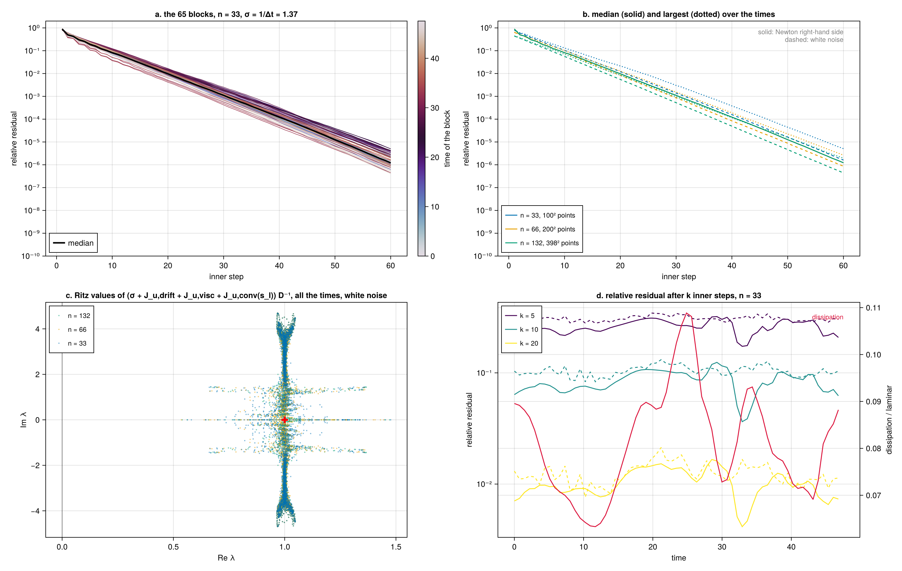
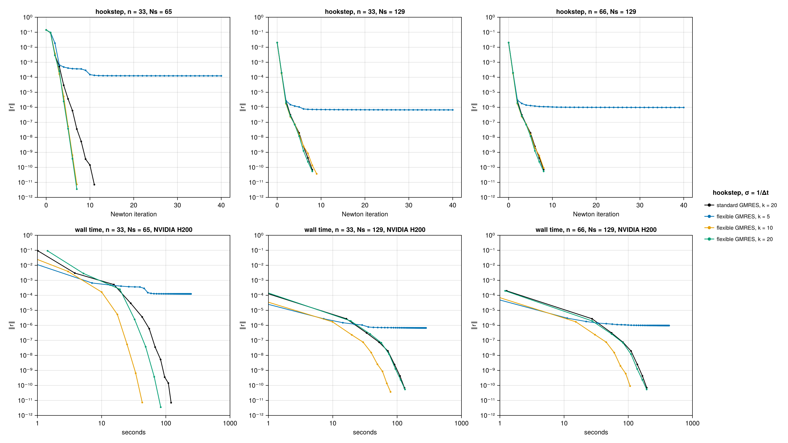

# Kolmogorov flow

Two-dimensional Kolmogorov flow is the flow on a doubly periodic square driven by a sinusoidal body
force. It is the standard setting for the computation of unstable periodic orbits of a turbulent
flow (Chandler & Kerswell 2013). This page describes the Kolmogorov flow example of the package.
It follows the paper *Space-time Newton–Krylov searches for unstable periodic orbits of
two-dimensional Kolmogorov flow* (Lasagna, in preparation), which is the reference for the method
and for the notation.

The model is in `examples/kolmogorov/kolmogorov.jl`. It provides the operators that a
[`System`](@ref) needs, the factorised preconditioner, and the tools to build an initial loop from a
simulation. Every operator acts on all instants of the loop at once, by fast Fourier transforms and
broadcasts. The same code runs on a CPU or on a GPU, in double or single precision.
`examples/kolmogorov/example.jl` integrates a turbulent trajectory on the CPU and takes its best
near recurrence as the initial loop. It converges the loop on a GPU, or on the CPU, with the
factorised preconditioner and flexible GMRES of this page and up to 300 Krylov vectors. The test
suite checks the model.

## Model

The flow lives on the torus $\mathbb{T}^2 = [0, 2\pi)^2$. Lengths and velocities are scaled as in
Chandler & Kerswell (2013). The vorticity $\eta = \partial_x v - \partial_y u$ obeys

```math
\partial_t \eta = \mathcal{N}(\eta) , \qquad
\mathcal{N}(\eta) = -\boldsymbol{u}[\eta]\cdot\nabla\eta + \frac{1}{Re}\nabla^2\eta - n\cos(n y) ,
```

with the velocity $\boldsymbol{u}[\eta] = (-\partial_y, \partial_x)\,\nabla^{-2}\eta$ induced by a
vorticity field of zero mean. The vorticity is written $\eta$ because $\omega$ is the frequency of
an orbit. The example uses the forcing wavenumber $n = 4$ and $Re = 40$, the most studied
configuration. The laminar flow $\eta = -(Re/n)\cos(n y)$ is then unstable, and the flow is weakly
turbulent, with intermittent bursts of dissipation. The vorticity formulation has a single scalar
unknown. Incompressibility holds by construction and the pressure does not appear.

## Orbits as zeros of a space-time residual

The equation is equivariant under the translations along the force, $x \to x + \ell$. Its recurrent
solutions are relative periodic orbits, which repeat after a period $T$ up to a shift $\ell$,

```math
\eta(x, y, t + T) = \eta(x + \ell, y, t) .
```

In the frame that drifts along $x$ with the speed $c = -\ell/T$ the orbit is periodic. In the
rescaled time $s = \omega t \in [0, 2\pi)$, with the frequency $\omega = 2\pi/T$, every orbit lives
on the same interval. An orbit is then a zero of the space-time residual

```math
r(\eta, \omega, c) = \omega\,\partial_s\eta - c\,\partial_x\eta - \mathcal{N}(\eta) ,
```

on loops that are periodic in $s$ and have zero spatial mean at every instant. The unknowns are
$p = (\eta, \rho, c)$, with $\rho = \log\omega$. In the code they form an
`Orbit(a, [log ω, c])`, and the drift direction is passed as `ddi = (ddx!,)`. The inner product of
two loops is the average of their product over space and over one period. This is the general
setting of the [Space-time formulation](@ref), with one drift direction.

The flow also has discrete symmetries, a shift-reflection and a rotation by $\pi$. The paper does
not seek the orbits that close only up to one of them. The keyword `yshift` of `KFGrid` makes a
loop periodic up to a translation across the force by a multiple of $2\pi/n$, if such orbits are
wanted.

## Discretisation

The loop is expanded in Fourier modes in space and in time,

```math
\eta(\boldsymbol{x}, s) = \sum_{\boldsymbol{k}} \sum_{m = -M}^{M}
\tilde\eta_{\boldsymbol{k} m}\, e^{\mathrm{i}(\boldsymbol{k}\cdot\boldsymbol{x} + m s)} ,
```

with the wavenumbers $|k_x|, |k_y| \le K$, without the mean, and $K = 33$.

- In space, a field is stored by its complex coefficients with $0 \le k_x \le K$ and
  $|k_y| \le K$. Those with $k_x < 0$ follow by conjugate symmetry. Each instant carries
  $(2K + 1)^2 - 1 = 4\,488$ real unknowns. Derivatives multiply the coefficients. The quadratic
  products are formed on a physical grid of $100 \times 100$ points and truncated back. This grid
  has $3K + 1$ points per direction and removes the aliasing by the 3/2 rule.
- In time, the loop is stored at $N_s = 2M + 1$ equispaced instants $s_l = 2\pi l/N_s$. The
  derivative in $s$ multiplies the harmonic $m$ by $\mathrm{i}m$, applied by FFTs along time. The
  paper uses ten instants per unit time, the resolution that guesses cut from a simulation need. It
  takes $N_s$ as the smallest odd number above $10\,T$ whose prime factors are 3, 5 and 7.
- In the discrete inner product the derivatives are exactly skew-adjoint. The
  adjoint operator is the exact transpose of the discrete linearised operator, with the advection
  in advective form in $\mathcal{L}$ and in conservative form in $\mathcal{L}^\dagger$. The
  gradient used by [`LBFGS`](@ref) is therefore exact to rounding.

A loop is an array of $(K + 1) \times (2K + 1) \times N_s$ complex numbers, a `KFField`. It has
$4\,488\,N_s$ real unknowns, about $4.5 \times 10^4$ per unit time at ten instants per unit time. A
loop of period 100 on 1 029 instants has $4.6 \times 10^6$ unknowns and occupies 37 MB in double
precision.

## The Newton system

The hookstep solves the Newton system of [Search by root finding](@ref), with the two phase
conditions $\langle \partial_s\eta, \delta\eta\rangle = 0$ and
$\langle \partial_x\eta, \delta\eta\rangle = 0$. The field block of its Jacobian is

```math
\mathcal{J}_\eta\,\delta\eta =
\underbrace{\omega\,\partial_s\delta\eta}_{\mathcal{J}_\mathrm{t}\,\delta\eta}
\ \underbrace{-\,c\,\partial_x\delta\eta}_{\mathcal{J}_\mathrm{drift}\,\delta\eta}
\ \underbrace{-\,\frac{1}{Re}\nabla^2\delta\eta}_{\mathcal{J}_\mathrm{visc}\,\delta\eta}
+ \underbrace{\boldsymbol{u}[\eta]\cdot\nabla\delta\eta
  + \boldsymbol{u}[\delta\eta]\cdot\nabla\eta}_{\mathcal{J}_\mathrm{conv}\,\delta\eta} ,
```

the time derivative, the drift, the viscous term and the convective term, all about the current
loop. No basis makes the whole block simple.

- $\mathcal{J}_\mathrm{t}$ is diagonal in the temporal harmonics, but couples all instants.
- $\mathcal{L}_0 = \mathcal{J}_\mathrm{drift} + \mathcal{J}_\mathrm{visc}$ has constant
  coefficients. It is diagonal in the spatial Fourier modes.
- $\mathcal{J}_\mathrm{conv}$ depends on the loop. It acts on each instant separately, but couples
  all spatial modes.

The spatial operator $\mathcal{J}_\mathrm{x} = \mathcal{L}_0 + \mathcal{J}_\mathrm{conv}$ is
therefore block diagonal at the instants, with one block $\mathcal{J}_\mathrm{x}(s_l)$ of 4 488
rows per instant.

## The factorised preconditioner

Without the convective term, $\mathcal{J}_\mathrm{t} + \mathcal{L}_0$ is diagonal in the space-time
Fourier modes. It multiplies the mode $(\boldsymbol{k}, m)$ by

```math
\lambda_{\boldsymbol{k} m} = \mathrm{i}(\omega m - c\,k_x) + \frac{|\boldsymbol{k}|^2}{Re} .
```

This diagonal preconditioner is enough for the Kuramoto–Sivashinsky equation. In Kolmogorov flow
it does no better than no preconditioner. The convective term dominates the spatial operator at the
energetic scales, and no diagonal operator can account for it.

The preconditioner of the example keeps the convective term. It is the product of a temporal factor
and of a spatial factor, each shifted by $\sigma > 0$,

```math
\mathcal{B} = \frac{1}{\sigma}\,(\mathcal{J}_\mathrm{t} + \sigma)(\sigma + \mathcal{J}_\mathrm{x})
            = \mathcal{J}_\eta + \sigma + \frac{1}{\sigma}\,\mathcal{J}_\mathrm{t}\mathcal{J}_\mathrm{x} .
```

The product contains the field block, plus a remainder. Its inverse applies each factor in the basis
where that factor is simple,

```math
\mathcal{B}^{-1} = \sigma\,
\mathrm{blockdiag}\big(\mathcal{X}_0^{-1}, \dots, \mathcal{X}_{N_s - 1}^{-1}\big)\,
\mathcal{F}^{-1}\,
\mathrm{diag}\big(\beta_{-M}^{-1}, \dots, \beta_M^{-1}\big)\,
\mathcal{F} ,
\qquad
\mathcal{X}_l = \sigma + \mathcal{J}_\mathrm{x}(s_l) , \quad
\beta_m = \sigma + \mathrm{i}\,\omega m ,
```

with $\mathcal{F}$ the discrete Fourier transform along time. An application has two steps.

1. In the frequency domain, the temporal harmonic $m$ is divided by $\beta_m/\sigma$. This costs two
   FFTs along time.
2. In the time domain, the blocks $\mathcal{X}_l z_l = g_l$ are solved at every instant. Each block is
   solved approximately, by ten steps of GMRES from zero, right-preconditioned by
   $\sigma + \mathcal{L}_0$, which is diagonal in Fourier. All blocks apply the same space-time
   operator. The inner iterations of all instants therefore form one batch, with separate inner
   products, Hessenberg matrices and least-squares problems per instant. The cost is about ten
   applications of the linearised operator. Nothing is formed or factorised.

The two parameters are divided by the norms of their columns of the Jacobian,
$\lVert \omega\,\partial_s\eta\rVert$ and $\lVert \partial_x\eta\rVert$. The borders of the Newton
system are not approximated further.

This is the approximate factorisation of alternating-direction implicit methods (Peaceman &
Rachford 1955; Beam & Warming 1976), here between time and space, as in the time-spectral solvers
of aerodynamics (Thomas et al. 2013; Mundis & Mavriplis 2017). $\mathcal{B}/\sigma$ approximates an
implicit Euler step of the linearised equations with the time step $1/\sigma$. The shift decides
which modes are well preconditioned. A natural choice is $\sigma = 1/\Delta t = N_s/T$. Then
$|\beta_m/\sigma|$ lies between 1 and $(1 + \pi^2)^{1/2}$ at every resolution. On grids that
over-resolve the orbits $1/\Delta t$ is too large, and the paper caps it,

```math
\sigma = \min(N_s/T,\ 2.5) .
```



*The inner GMRES on the blocks $\mathcal{X}_l$, right-preconditioned by $\sigma + \mathcal{L}_0$,
for a loop on 65 instants with $\sigma = 1/\Delta t = 1.37$. In the figure, $n$ is the cutoff $K$
and $\mathcal{J}_{u,\cdot}$ stands for $\mathcal{J}_\cdot$. (a) The relative residual of every block
against the inner steps, $K = 33$. (b) The median and the largest residual over the instants, at
$K = 33$, 66 and 132. (c) The Ritz values of the preconditioned blocks. (d) The residual after
5, 10 and 20 inner steps at each instant.*

The preconditioned blocks have their eigenvalues in a strip of real parts between 0.5 and 1.5, at
every spatial resolution. All blocks converge at the same rate, a factor of ten every nine to ten
inner steps. A fixed number of inner steps therefore serves every resolution.

Ten inner steps solve the blocks only to about $10^{-1}$. The preconditioner is then a slightly
different operator at each Arnoldi step. The hookstep therefore uses flexible GMRES,
`NewtonHookstep(flexible=true)`, which keeps the preconditioned vectors and forms the step from
them (see [Preconditioning](@ref)). Flexible GMRES stores two loops per Krylov vector, and the
memory of the GPU limits the dimension of the Krylov space. The inexact inner solves also leave the
preconditioner without an adjoint. It serves the hookstep only.



*Hookstep searches from a seed orbit with $\sigma = 1/\Delta t$ on an NVIDIA H200, at three
resolutions ($n$ is the cutoff $K$). Standard GMRES with $k = 20$ inner steps, and flexible GMRES
with $k = 5$, 10 and 20. Top, the residual against the Newton iterations. Bottom, against the wall
time.*

With flexible GMRES and ten inner steps the number of Newton iterations does not depend on the
spatial resolution. Five inner steps are too few, and the search stalls. Twenty take as many Newton
iterations as ten, at twice the cost.

## Running a search

Initial loops come from near recurrences of long simulations, where the flow returns close to an
earlier state up to a translation along $x$. The paper finds them by scanning the distance

```math
d(t, T) = \min_{\ell} \frac{\lVert \eta(x + \ell, y, t) - \eta(x, y, t + T)\rVert}{\lVert\eta(t)\rVert}
```

along the simulations for local minima below 0.25. A near recurrence gives the state $\hat\eta_0$
at its start, the period $T$ and the shift $\ell$. The code below turns them into a loop and
converges it with the settings of the paper. It runs on the CPU as written. To run on a GPU, load
CUDA.jl and pass `array=CuArray` to the grid. The loop is built on the CPU and copied to the device.

```julia
using ReSolver
include("examples/kolmogorov/kolmogorov.jl")

# ---- a near recurrence: the state at its start, the period and the shift along x ----
K  = 33
η̂₀ = …   # (K + 1) × (2K + 1) coefficients, e.g. coefficients(Ω, K) of a state Ω of OpenKolmogorovFlow.jl
T  = …
ℓ  = …

# ---- the guess on Ns instants, ten per unit time ----
Ns = minimum(3^a * 5^b * 7^c for a in 0:8, b in 0:6, c in 0:5 if 3^a * 5^b * 7^c >= 10T)
g  = KFGrid(K, Ns; Re=40, kf=4)
x  = initial_orbit([η̂₀], g, T, ℓ)       # Orbit: field, [log ω, c]

# ---- the system, with the factorised preconditioner ----
B = KFPreconditioner(x; kind=:factorised, σ=min(Ns / T, 2.5), inner=10)
F = System(KFNonlinear(g), KFLinearised(g), KFLinearised(g; adjoint=true), dds!, x;
           linearise!, ddi=(ddx!,), B)

# ---- the hookstep, with flexible GMRES ----
trace = Trace()
solve!(x, F, NewtonHookstep(maxiter=60, krylov_dim=1000, krylov_tol=1e-2, Δ=0.1, Δmax=10,
                            tol=1e-12, flexible=true, callback=trace))

2π / ReSolver.frequency(x), x.p[2]    # period and drift speed
```

`initial_orbit` integrates the state over one period by ETDRK4, samples the trajectory on the $N_s$
instants and writes it in the frame that drifts with $c = -\ell/T$. The preconditioner is rebuilt
about the current loop at every Newton iteration, by [`ReSolver.relinearise!`](@ref). The hookstep
does not apply the adjoint operator, so `KFLinearised(g; adjoint=true)` can be left out of the
`System`, as `example.jl` does. The function `integrate` advances a state on the CPU, for short
trajectories. The function `recurrence` finds the best near recurrence of a sampled trajectory, with
its shifts along $x$ and across the force. For an orbit that closes
up to a translation across the force by $\ell_y$, a multiple of $2\pi/n$, the grid takes the
keyword `yshift=ℓy`. Such orbits are outside the scope of the paper.

Some notes on the settings.

- The Newton systems are solved to $10^{-2}$ of the right-hand side. Long orbits
  need large Krylov spaces. An orbit of period 114.5 stalls with 300 vectors and converges with
  1 000. On a GPU the dimension is limited by its memory.
- A loop cut from a simulation jumps at its junction. The paper removes the jump
  before the search, by a weighted average of the two trajectories that meet there. This step is
  not part of the example.
- A first descent stage is optional. [`LBFGS`](@ref) or gradient descent, `LBFGS(memory=0)`,
  can reduce the residual before the hookstep, with the positive diagonal preconditioner
  `KFPreconditioner(x; kind=:linear)`, which has an adjoint. The paper tests whether this stage
  helps.
- After convergence, check that the highest temporal harmonic holds a
  negligible share of the energy. Otherwise interpolate the orbit on more instants and converge it
  again.

## Code reference

`kolmogorov.jl` defines the following. The names of the code differ from the notation of this page
in three places. The cutoff $K$ is `n`, the forcing wavenumber $n$ is `kf`, and the comments of the
code write the vorticity as `ω`.

| name | what it is |
|---|---|
| `KFGrid(n, Ns; Re=40, kf=4, yshift=0, array=Array, precision=:double)` | wavenumbers, FFT plans and work arrays, on the device of `array`, in double or single precision |
| `KFField(g)` | a loop, the coefficients at the $N_s$ instants, zero |
| `KFNonlinear(g)` | the operator $\mathcal{N}$ |
| `KFLinearised(g; adjoint=false)` | the linearised operator $\mathcal{L}$, or its adjoint |
| `linearise!(op, a)` | sets the loop about which `op` is linearised |
| `ddx!(out, a)`, `dds!(out, a)` | the derivatives along $x$ and in $s$ |
| `KFPreconditioner(x; kind=:jacobian, σ=3, inner=5)` | the preconditioners, built about the orbit `x` |
| `integrate(η̂₀, g, dt, nsteps; every=1)` | time integration of one state by ETDRK4, on the CPU |
| `recurrence(W, g, Δt, Trange; motion=0.3)` | the best near recurrence `(e, i, m, ℓx, ℓy)` of the states `W[:, :, i]`, sampled every `Δt`, with a period in `Trange`, a shift `ℓx` along $x$ and a shift `ℓy` across the force, a multiple of $2\pi/n$ |
| `initial_orbit(seeds, g, T, ℓx)` | an initial loop of period `T` from a vector of states, the starts of equal segments of the period |
| `initial_orbit(W, g, Δt, i, m, ℓx)` | an initial loop of period `m Δt` from the state `W[:, :, i]` of a trajectory sampled every `Δt` |
| `coefficients(Ω, n)` | the coefficients of a state given in the layout of OpenKolmogorovFlow.jl |
| `physical(a, l)` | the vorticity at the instant $s_l$ on the physical grid, on the CPU |

`KFPreconditioner` has three kinds.

| kind | divides the mode $(\boldsymbol{k}, m)$ by | use |
|---|---|---|
| `:jacobian` (default) | $\lambda_{\boldsymbol{k} m}$ | the diagonal preconditioner, which fails here |
| `:linear` | $1 + \lvert\lambda_{\boldsymbol{k} m}\rvert$ | a positive metric for L-BFGS |
| `:factorised` | the factorised $\mathcal{B}$ above | the hookstep, with `flexible=true` |

The defaults `σ=3` and `inner=5` of the factorised kind are not the settings of the paper. Pass
`σ=min(Ns / T, 2.5)` and `inner=10` explicitly.

## References

- R. M. Beam and R. F. Warming, *An implicit finite-difference algorithm for hyperbolic systems in
  conservation-law form*, J. Comput. Phys. 22, 87–110 (1976).
- G. J. Chandler and R. R. Kerswell, *Invariant recurrent solutions embedded in a turbulent
  two-dimensional Kolmogorov flow*, J. Fluid Mech. 722, 554–595 (2013).
- D. Lasagna, *Space-time Newton–Krylov searches for unstable periodic orbits of two-dimensional
  Kolmogorov flow*, in preparation.
- J. Mundis and D. J. Mavriplis, *Toward an optimal solver for time-spectral fluid-dynamic and
  aeroelastic solutions on unstructured meshes*, J. Comput. Phys. 345, 132–161 (2017).
- D. W. Peaceman and H. H. Rachford, *The numerical solution of parabolic and elliptic
  differential equations*, J. Soc. Ind. Appl. Math. 3, 28–41 (1955).
- Y. Saad, *A flexible inner-outer preconditioned GMRES algorithm*, SIAM J. Sci. Comput. 14,
  461–469 (1993).
- J. P. Thomas, C. H. Custer, E. H. Dowell, K. C. Hall and C. Corre, *Compact implementation
  strategy for a harmonic balance method within implicit flow solvers*, AIAA J. 51, 1374–1381
  (2013).
