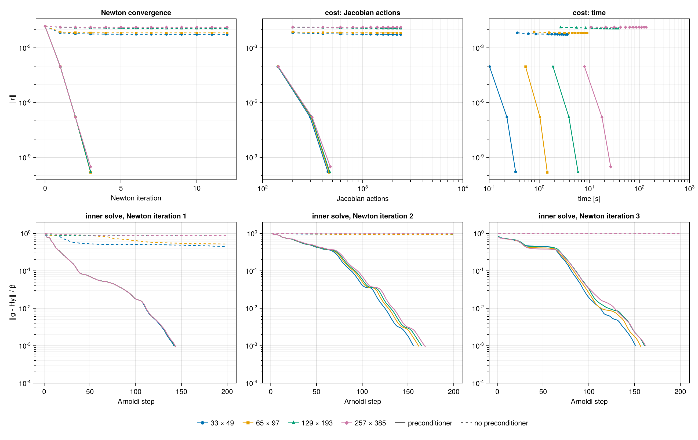
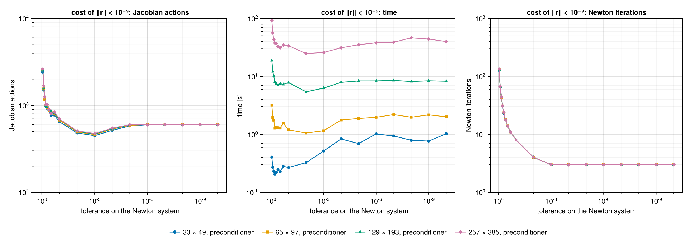
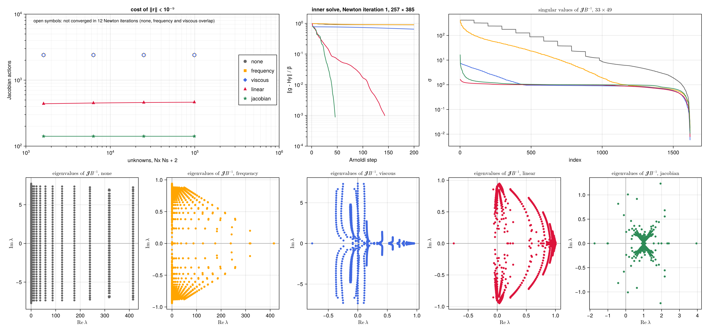

# Kuramoto–Sivashinsky equation

The Kuramoto–Sivashinsky equation is the standard testbed for the computation of invariant solutions
of spatio-temporally chaotic PDEs. Unlike the Lorenz system, its space-time problem is stiff in both
directions, along rescaled time through the frequency and along space through a fourth-order
dissipation. This page searches for relative periodic orbits on the domain studied by Cvitanović,
Davidchack & Siminos (2010) and finds the shortest pre-periodic orbit of the system. It then studies
the convergence of the hookstep on grids of up to $10^5$ unknowns and compares five
preconditioners. The model is defined in `examples/kuramoto_sivashinsky/ks.jl`, and
`examples/kuramoto_sivashinsky/example.jl` converges the orbit. The scripts `convergence.jl` and
`preconditioners.jl` in `examples/kuramoto_sivashinsky/scripts/` produce the other figures.

## Problem

The equation

```math
\partial_t u = -u\,\partial_x u - \partial_x^2 u - \partial_x^4 u , \qquad x \in [0, L) , \tag{1}
```

with periodic boundary conditions and $L = 22$, is chaotic. It is equivariant under translations
$u(x) \to u(x + \ell)$ and under the reflection $u(x) \to -u(-x)$. It is Galilean invariant,
$u(x, t) \to u(x - Ct, t) + C$, and it conserves the mean of $u$, set to zero here. Because of the
translation symmetry, its recurrent solutions are relative periodic orbits, which repeat after a
period $T$ up to a shift $\ell$. In the moving frame they are periodic, with drift speed
$c = -\ell/T$. The unknowns are the field over one period, the log-frequency and the drift speed,
and $\partial_x$ is the derivative along the single drift direction.

## Discretisation

A `KSField` holds the values $u(x_j, s_l)$ on the grid

```math
x_j = (j - 1)\,\frac{L}{N_x}, \qquad s_l = (l - 1)\,\frac{2\pi}{N_s}, \qquad
j = 1, \dots, N_x, \quad l = 1, \dots, N_s , \tag{2}
```

with $N_x$ and $N_s$ odd, so that no unpaired Nyquist mode breaks the skew-adjointness of the
spectral derivatives. A `KSTransformedField` holds its Fourier coefficients $\hat u_{k n}$, by a
real FFT along $x$ and a full FFT along $s$, with $k = 2\pi m / L$, $0 \le m \le (N_x - 1)/2$, and
$|n| \le (N_s - 1)/2$. The transforms are planned once, in a `KSFFT` owned by the grid. The
derivatives and the linear operator $k^2 - k^4$ are applied to the coefficients, and the quadratic
term on the grid. The inner product is the mean over the grid points,

```math
\langle u, v\rangle = \frac{1}{N_x N_s} \sum_{j, l} u(x_j, s_l)\, v(x_j, s_l) , \tag{3}
```

the discretisation of $\frac{1}{2\pi L}\int_0^{2\pi}\!\!\int_0^L u\,v\;\mathrm{d}x\,\mathrm{d}s$,
so that norms and tolerances do not depend on the resolution.

### Removing the mean

The nonlinear operator is the right-hand side of (1),

```math
N(u) = (k^2 - k^4)\,\hat u - \tfrac12\,\partial_x(u^2) . \tag{4}
```

The linearised operator about $U$ is $L v = (k^2 - k^4)\,v - \partial_x(U v)$, and its adjoint is
$L^+ w = (k^2 - k^4)\,w + U\,\partial_x w$. Both are exact for the discrete operators, because the
derivatives are exactly skew-adjoint in (3).

Galilean invariance has a consequence for the space-time problem. Adding a constant $C$ to an orbit
and to the drift speed gives another solution. The pair $(\delta u, \delta c) = (C, C)$ is then a
null vector of the Jacobian. A constant is orthogonal to both $\partial_s u$ and $\partial_x u$, so
the phase conditions do not remove it. Every term of (4) is an $x$-derivative, so $N(u)$ has zero
mean for every $u$, and the equation of the mean is void. Both defects lie along the constant field.

The search removes them with the projection `demean!` of `ks.jl`, passed to [`System`](@ref) as
`project=demean!`. It subtracts the space-time mean of a field, an orthogonal projection in (3), and
the search then runs on the fields of zero mean, as on a
[symmetric subspace](../usage.md#Symmetric-subspaces). On these fields the condition number of
$\mathcal{J}$ at the orbit below is $2.4 \times 10^{4}$, against $10^{16}$ on all fields. With the
log-frequency and the drift speed, the problem has

```math
N = N_x N_s + 2 \tag{5}
```

real unknowns, of which the projection fixes one, the mean. The grids used below are the following.

| grid | $N_x \times N_s$ | unknowns $N$ | largest wavenumber $k_{\max}$ | largest $k_{\max}^4$ |
|---|---|---|---|---|
| base | $33 \times 49$ | 1 619 | 4.6 | $4.4 \times 10^{2}$ |
| $\times 2$ | $65 \times 97$ | 6 307 | 9.1 | $7.0 \times 10^{3}$ |
| $\times 4$ | $129 \times 193$ | 24 899 | 18.3 | $1.1 \times 10^{5}$ |
| $\times 8$ | $257 \times 385$ | 98 947 | 36.6 | $1.8 \times 10^{6}$ |

The last column measures the stiffness of the dissipation, which grows by four orders of magnitude
from the base grid to the finest. It also limits the attainable residual. Rounding errors of
relative size $10^{-16}$ in the quadratic term are amplified by up to $k_{\max}^4$, and on the
finest grid the residual stagnates around $10^{-10}$. The convergence studies below therefore stop
at $\lVert r\rVert < 10^{-9}$.

## Initial guess

A trajectory of (1) is integrated with the fourth-order exponential time-differencing Runge–Kutta
scheme of Kassam & Trefethen (2005), with step $0.05$, from a random initial condition of zero mean,
for 400 time units after a transient of 200. Near recurrences are sought among the snapshots, every
$0.25$ time units, by minimising $\lVert u(t_0 + T_0) - u(t_0 + \cdot\, ; \ell)\rVert$ over the
start $t_0$, the lag $T_0 \in [12, 20]$ and the shift $\ell$. Starts where the trajectory is
nearly stationary are excluded. At $L = 22$ the dynamics visits equilibria and travelling waves.
Without this filter the best recurrence is a nearly steady stretch, which converges to an
equilibrium rather than to an orbit. The best recurrence has relative error 0.17, with
$T_0 = 20.00$ and $\ell = 0.69$. The segment from $t_0$ is integrated again on the $N_s$ rescaled
times and written in the frame drifting with $c = -\ell/T_0$.

## The shortest pre-periodic orbit

From this guess, with $N_x \times N_s = 33 \times 49$, the hookstep alone converges, without
L-BFGS, provided the Newton systems are preconditioned. The searches below use Krylov spaces of at
most 150 vectors, $\tau = 10^{-3}$ and an initial trust-region radius $0.1$.

| preconditioner (see [below](#Preconditioners)) | Newton iterations | of which hooksteps | Jacobian actions | final $\lVert r\rVert$ | orbit |
|---|---|---|---|---|---|
| none | 50 | 0 | 7500 | $2.5 \times 10^{-2}$ | not converged |
| linear | 13 | 8 | 1863 | $3.0 \times 10^{-14}$ | $T = 20.5057$ |
| jacobian | 9 | 5 | 441 | $1.2 \times 10^{-12}$ | $T = 20.5057$ |

*From $\lVert r\rVert = 7.8 \times 10^{-2}$, with at most 50 Newton iterations.*


*Top, the initial guess and the converged orbit over one period, in the fixed frame. Middle and
bottom, the search without preconditioner, stopped after 10 iterations, and with the jacobian
preconditioner. Left, the residual against the Newton iterations, with hooksteps on the boundary of
the trust region as open symbols and full Newton steps filled. Right, the relative residual of the
GMRES solution of the Newton system against the Arnoldi steps, one curve per Newton iteration, with
the tolerance $10^{-3}$ dashed.*

Without preconditioner every Newton system stalls at the largest Krylov space, with a relative
residual between $0.3$ and $1$. The steps are least-squares solutions in a Krylov space far too
small, and they reduce the residual very little, by a factor of three in 50 iterations. With the
jacobian preconditioner each Newton system is solved to $10^{-3}$ in 45 to 55 Arnoldi steps, at
every iteration, and the search has two phases. In the first five iterations the Newton step is
longer than the trust region, with $\lVert \mathcal{B}\,\delta p\rVert$ between $0.3$ and $1.5$
against a radius of $0.1$ to $0.2$. The hookstep takes the best part of it that the trust region
allows, and the residual decreases slowly, from $7.8 \times 10^{-2}$ to $1.5 \times 10^{-2}$. From
the sixth iteration on the full Newton step lies inside the trust region. The residual drops to
$1.2 \times 10^{-3}$, $1.5 \times 10^{-6}$, $1.2 \times 10^{-9}$ and $1.2 \times 10^{-12}$, and
converges linearly with a ratio close to $\tau = 10^{-3}$ (see
[Tolerance of the inner solve](#Tolerance-of-the-inner-solve)).

The converged orbit has zero mean, zero drift speed and period $T = 20.505745$. It is the shortest
*pre-periodic* orbit of the system, $\mathrm{PPO}_{10.25}$ in the notation of Cvitanović,
Davidchack & Siminos (2010), traversed twice. Half a period later the field is the reflection of
its initial state, $u(x, s + \pi) = -u(x_0 - x, s)$ with $x_0 = 12.139$, to a relative error of
$4 \times 10^{-5}$ limited by the resolution of the search over $x_0$, and $T/2 = 10.2529$. The
formulation does not exploit the reflection symmetry, so it finds the orbit as a periodic orbit of
twice the period. The drift speed, an unknown of the search, converges to zero.

## Convergence of the hookstep

As for the Lorenz system, the converged orbit is interpolated spectrally to grids refined by 1, 2,
4 and 8 in both directions. Its log-frequency and drift speed are perturbed by $0.01$ and its field
by 1% on the modes $|m| \le 3$, $|n| \le 3$. The hookstep is run with the Newton system solved to
$\tau = 10^{-3}$, without preconditioner and with the linear one.



*Top, residual against the Newton iterations, the Jacobian actions and the computing time. Bottom,
relative residual of the Newton system after each Arnoldi step, for the first three Newton
iterations. Solid lines, linear preconditioner. Dashed lines, none.*

| grid | unknowns | $\lVert r\rVert$, no preconditioner | Jacobian actions | $\lVert r\rVert$, linear preconditioner | Newton iterations | Jacobian actions | time |
|---|---|---|---|---|---|---|---|
| base | 1 619 | $5.5 \times 10^{-3}$ | 2400 | $1.6 \times 10^{-10}$ | 3 | 449 | 0.3 s |
| $\times 2$ | 6 307 | $6.6 \times 10^{-3}$ | 2400 | $1.5 \times 10^{-10}$ | 3 | 462 | 1.5 s |
| $\times 4$ | 24 899 | $1.2 \times 10^{-2}$ | 2400 | $1.6 \times 10^{-10}$ | 3 | 469 | 6.0 s |
| $\times 8$ | 98 947 | $1.4 \times 10^{-2}$ | 2400 | $3.0 \times 10^{-10}$ | 3 | 475 | 26.8 s |

*Final residual and cost, from $\lVert r\rVert = 1.6 \times 10^{-2}$. Without preconditioner the
search is stopped after 12 Newton iterations.*

With the preconditioner, Newton converges in 3 iterations on every grid. The cost in Jacobian
actions grows by 6% over a 61-fold increase of the number of unknowns, so the method is
mesh-independent. The computing time grows by factors between 4 and 5 between successive grids.
This is close to the factor of four by which the number of unknowns grows, times the logarithm of
the FFTs, so the work per unknown is nearly constant. The residual drops from $1.6 \times 10^{-2}$
to $1.2 \times 10^{-4}$, $1.5 \times 10^{-7}$ and $2 \times 10^{-10}$. After the first step the
convergence is linear with ratio $10^{-3}$, the tolerance of the inner solve, rather than
quadratic. This is the behaviour of an inexact Newton method whose forcing term is constant
(Dembo, Eisenstat & Steihaug 1982). Each step reduces the residual of the linear model by $\tau$,
and once the error of the linearisation, quadratic in the step, falls below that, $\tau$ sets the
rate.

Each inner solve takes 145 to 170 Arnoldi steps, and the curves of the four grids nearly coincide.
They descend in stages, with plateaus, for instance at a relative residual of about $0.4$ during the
first 70 steps of the third iteration. GMRES first resolves the eigenvalues of
$\mathcal{J}\mathcal{B}^{-1}$ that lie far from one, on the arcs towards $\pm\mathrm{i}$ described
in [Preconditioners](#Preconditioners), and only then converges at the rate set by the cluster.
These eigenvalues belong to the large scales, which are the same on every grid, hence the
independence of the resolution.

Without preconditioner, every inner solve exhausts the Krylov space of 200 vectors. In the first
Newton iteration the relative residual of the Newton system stagnates between $0.45$ and $0.9$,
and in the following ones it stays close to one. The steps are almost useless. After 12 iterations
and 2400 Jacobian actions the residual has dropped by a factor of three on the base grid, and
hardly at all on the finest. For the Lorenz system the unpreconditioned solve succeeds as long as
the Krylov space can span the whole problem. Here the problem is larger than the Krylov space
already on the base grid, with 1 619 unknowns.

## Tolerance of the inner solve



*Cost of $\lVert r\rVert < 10^{-9}$ in Jacobian actions, time and Newton iterations, against the
tolerance on the Newton system, with the linear preconditioner. Missing points did not converge
within 200 Newton iterations. Without preconditioner the search converges at no tolerance, even on
the base grid.*

| $\tau$ | Newton iterations | Jacobian actions, base | $\times 8$ | mean contraction of $\lVert r\rVert$ per iteration |
|---|---|---|---|---|
| 0.95 | not converged | — | — | — |
| 0.9 | 128–134 | 2415 | 2627 | 0.88 |
| 0.8 | 66–67 | 1513 | 1684 | 0.78 |
| 0.5 | 23–24 | 924 | 1017 | 0.49 |
| 0.3 | 14 | 770 | 806 | 0.31 |
| 0.1 | 8 | 647 | 697 | 0.13 |
| $10^{-2}$ | 4 | 482 | 509 | |
| $10^{-3}$ | 3 | 449 | 475 | |
| $10^{-4}$ | 3 | 517 | 548 | |
| $\le 10^{-6}$ | 3 | 600 | 600 | |

*Cost of $\lVert r\rVert < 10^{-9}$ from $\lVert r\rVert = 1.6 \times 10^{-2}$, linear
preconditioner. The ranges of Newton iterations cover the four grids. The mean contraction is
$(10^{-9} / 1.6 \times 10^{-2})^{1/n}$ over the $n$ iterations on the base grid.*

The number of Newton iterations depends on the tolerance and not at all on the grid. For loose
tolerances it follows the theory of inexact Newton methods closely. The residual contracts by a
factor equal to $\tau$ at every iteration, 0.88 for $\tau = 0.9$, 0.49 for $\tau = 0.5$ and 0.31
for $\tau = 0.3$. The hookstep takes the full inexact Newton step, whose linear model reduces the
residual by exactly $\tau$, and the linearisation error is negligible at these small residuals. For
$\tau = 0.95$ the contraction is too weak to reach $10^{-9}$ within 200 iterations.

The cost in Jacobian actions has a minimum at $\tau = 10^{-3}$ on every grid, 449 to 475 actions,
and is flat around it. The tolerance $10^{-2}$ costs 7% more and $10^{-4}$ costs 15% more.
Tightening the tolerance beyond $10^{-5}$ changes nothing. Each inner solve then fills the whole
Krylov space of 200 vectors, and the cost saturates at $3 \times 200 = 600$ actions. These searches
still converge, because 200 Arnoldi steps reduce the residual of the Newton system well below what
Newton needs to converge in 3 iterations. Loosening the tolerance is costlier, up to five times the
minimum at $\tau = 0.9$. The minimum lies at a tighter tolerance than for the Lorenz system, where
it was $10^{-4}$ with the jacobian preconditioner, but the reason is the same. With Newton
converging in 3 or 4 iterations, a tighter inner solve buys nothing, and a looser one multiplies
the iterations.

The computing time behaves differently on the smallest grids. On the base grid the fastest searches
use loose tolerances, $\tau$ between 0.3 and 0.7, at about 0.22 s against 0.52 s at $10^{-3}$.
With 1 619 unknowns a Jacobian action is cheap. The time is dominated by the orthogonalisation of
the Arnoldi vectors, whose cost grows with the square of the dimension of the Krylov space, and by
the dense linear algebra of the hookstep. Many short Krylov spaces are then cheaper than a few long
ones. As the grid is refined, the Jacobian actions become dominant and the minimum of the time moves
to the minimum of the actions. On the finest grid the fastest searches use $\tau = 10^{-2}$ and
$10^{-3}$, at 25 and 26 s, against 92 s at $\tau = 0.9$. For large problems, where the Jacobian
action is the expensive operation, the count of actions is the relevant measure, and a tolerance
between $10^{-2}$ and $10^{-4}$ is a safe choice.

## Preconditioners

### What the Newton system contains

The block of the Jacobian that acts on the field, the derivative of the residual with respect to
the field (see [Search by root finding](@ref)), is

```math
\mathcal{J}_u\,v = \omega\,\partial_s v - c\,\partial_x v - L\{u\}\,v ,
\qquad
L\{u\}\,v = \underbrace{-\,\partial_x^2 v - \partial_x^4 v}_{\text{linear part of KS}}
          \;\underbrace{-\,\partial_x (u\,v)}_{\text{advection by the orbit}} , \tag{6}
```

with $L\{u\}$ the linearisation of (4) about the current orbit $u$. A preconditioner $\mathcal{B}$
should approximate $\mathcal{J}_u$ and be cheap to invert. All the terms of (6) but one act on each
space-time Fourier mode of $v$ separately. The exception is the advection $\partial_x(u\,v)$. As a
product in physical space, it couples every Fourier mode of $v$ to every other, through the modes of
$u$. In the Fourier basis it is a dense matrix of the size of the whole problem, and so is
$\mathcal{J}_u$. Inverting it would mean solving a linear system as large and as hard as the Newton
system itself, which the preconditioner is meant to make easier. The preconditioners below leave
the advection out.

### Why the preconditioners are diagonal

Every Fourier mode of the space-time grid, $e_{kn} = e^{\mathrm{i}(k x + n s)}$, with wavenumber
$k$ and temporal index $n$, is an eigenfunction of the derivatives, with $\partial_s \to \mathrm{i}\,n$,
$\partial_x \to \mathrm{i}\,k$, $\partial_x^2 \to -k^2$ and $\partial_x^4 \to k^4$. Two
simplifications make $\mathcal{J}_u$ act on each mode separately. The first drops the advection,
which amounts to linearising about the mean state $u = 0$ rather than about the orbit. The second
freezes the frequency and the drift speed, which change during a search, at the values $\omega_0$
and $c_0$ of the initial guess $(u_0, \log\omega_0, c_0)$, the orbit from which the preconditioner
is built. Then $\mathcal{B}$ does not change during the search. What is left multiplies each mode
by a number, its eigenvalue, which depends on $k$ and $n$,

```math
\omega_0\,\partial_s e_{kn} - c_0\,\partial_x e_{kn} + \partial_x^2 e_{kn} + \partial_x^4 e_{kn}
= \lambda_{kn}\, e_{kn} ,
\qquad
\lambda_{kn} = \mathrm{i}(\omega_0 n - c_0 k) + k^4 - k^2 , \tag{7}
```

with $\lambda_{00} = 0$ on the mean. The projection removes that mode. The real part of
$\lambda_{kn}$ comes from the linear part of the equation, the imaginary part from the time
derivative and the drift.

The preconditioners are of the same kind. Each multiplies the mode $e_{kn}$ by a number,
$\mathcal{B}\,e_{kn} = b_{kn}\,e_{kn}$, and its inverse divides by it. They are *diagonal in
Fourier*, since each Fourier coefficient of $\mathcal{B}^{-1}v$ depends only on the same
coefficient of $v$. In `ks.jl` an orbit is stored as values on the space-time grid, so
`KSPreconditioner` applies $\mathcal{B}^{-1}$ in three steps. A two-dimensional FFT gives the
space-time Fourier coefficients, each coefficient is divided by $b_{kn}$, and the inverse FFT
returns to the grid. The adjoint $\mathcal{B}^{-+}$ divides by the complex conjugates
$\overline{b_{kn}}$.

### Five preconditioners

The five preconditioners differ in which parts of $\lambda_{kn}$ they keep, and whether they keep
its phase or only its size.

| name | multiplier $b_{kn}$ | keeps of $\mathcal{J}_u$ |
|---|---|---|
| none | $1$ | nothing |
| frequency | $1 + \lvert \omega_0 n - c_0 k\rvert$ | the size of the time derivative in the moving frame, $\omega\,\partial_s - c\,\partial_x$ |
| viscous | $1 + k^4$ | the size of the fourth-order dissipation, $\partial_x^4$ |
| linear | $1 + \lvert \lambda_{kn}\rvert$ | the size of the whole linear part, $\lvert \lambda_{kn}\rvert$ |
| jacobian | $\lambda_{kn}$ | the whole linear part, phase included |

The first four are real and positive, hence self-adjoint, $\mathcal{B}^{-+} = \mathcal{B}^{-1}$.
The added $1$ keeps them bounded below by one, so that no mode is amplified, and invertible on the
mean. The jacobian preconditioner is complex. It is the linear part (7) of $\mathcal{J}_u$ itself,
the analogue of the jacobian preconditioner of the Lorenz system, since the mean of the orbit is
zero and the Jacobian of the right-hand side at the mean state is the linear operator. Its
multipliers are smallest on the linearly unstable wavenumbers $0 < k < 1$ at $n = 0$, between
$0.075$ and $0.22$ in modulus. None vanishes except $\lambda_{00}$, which the code replaces by 1,
since the projection removes the mean. None of the five contains the advection by the
orbit, which below causes the eigenvalues of $\mathcal{J}\mathcal{B}^{-1}$ that lie away from one.
On the parameters all five divide the log-frequency by $\lVert \omega_0\,\partial_s u_0\rVert$ and
the drift speed by $\lVert \partial_x u_0\rVert$, the norms of their columns of the Jacobian. In
the code, `KSPreconditioner(x; kind)` in `ks.jl` computes the multipliers once, from the initial
orbit `x`.



*Top left, Jacobian actions to $\lVert r\rVert < 10^{-9}$ against the number of unknowns, with
$\tau = 10^{-3}$. The open symbols of the three preconditioners that do not converge overlap. Top
centre, relative residual of the Newton system in the first Newton iteration, finest grid. Top
right, singular values of $\mathcal{J}\mathcal{B}^{-1}$ at the converged orbit, base grid. Bottom,
eigenvalues of $\mathcal{J}\mathcal{B}^{-1}$, base grid.*

| grid | unknowns | none | frequency | viscous | linear | jacobian |
|---|---|---|---|---|---|---|
| base | 1 619 | — | — | — | 439 | 141 |
| $\times 2$ | 6 307 | — | — | — | 450 | 141 |
| $\times 4$ | 24 899 | — | — | — | 458 | 141 |
| $\times 8$ | 98 947 | — | — | — | 463 | 141 |
| $\kappa(\mathcal{J}\mathcal{B}^{-1})$, base | | $2.4 \times 10^{4}$ | $3.0 \times 10^{4}$ | $1.3 \times 10^{3}$ | $2.2 \times 10^{2}$ | $1.6 \times 10^{3}$ |

*Jacobian actions to $\lVert r\rVert < 10^{-9}$, with $\tau = 10^{-3}$, Krylov spaces of at most
200 vectors and at most 12 Newton iterations. A dash marks a search that did not converge, after
2400 actions, with final residuals between $2 \times 10^{-4}$ and $1.5 \times 10^{-2}$. The last
row is the condition number at the converged orbit on the base grid, on the fields of zero mean.*

Two preconditioners converge, both in 3 Newton iterations on every grid, and both at a cost that does
not grow with the resolution, although the number of unknowns grows by a factor of 61. The linear
one costs about 450 Jacobian actions and the jacobian one 141. The other three exhaust the Krylov
space of 200 vectors in every Newton iteration without reaching the tolerance of the inner solve,
and the hookstep, with truncated steps, stalls.

The eigenvalues (7) explain the costs. They lie on vertical lines in the complex plane, one for each
wavenumber, at $\mathrm{Re}\,\lambda_{kn} = k^4 - k^2$, and spread along the imaginary axis up to
$\pm\,\omega_0 N_s/2$. The spectrum of $\mathcal{J}$ follows this structure, with the advection
$-\partial_x(u\,\cdot)$ as a perturbation. Below, $\mu$ denotes an eigenvalue of
$\mathcal{J}\mathcal{B}^{-1}$.

- Without preconditioner the eigenvalues fill a region that extends along the real axis to
  $\mathrm{Re}\,\mu \approx 400$, the value of $k_{\max}^4$ on the base grid, and to $\pm 7$ along
  the imaginary axis. On the finest grid the real extent is $1.8 \times 10^{6}$. A residual
  polynomial of low degree cannot be small on such a region and equal to one at the origin.
- The frequency preconditioner divides by $1 + |\omega_0 n - c_0 k|$. It compresses the imaginary
  extent, and the eigenvalues of the slow modes fan towards $\pm\mathrm{i}$, as for Lorenz. The
  dissipation is untouched, though, and the spread along the real axis, which grows as
  $k_{\max}^4$, remains. The condition number is even larger than without preconditioner.
- The viscous preconditioner divides by $1 + k^4$. It maps the dissipative part of each line to a
  real part of order one, and the singular values become flat. The condition number drops to
  $1.3 \times 10^{3}$. The time derivative of the large scales is untouched, though. For small $k$
  the eigenvalues remain on lines close to the imaginary axis, up to
  $\pm\,\omega_0 N_s/2 \approx \pm 7.4$, on both sides of the origin. This is the spectrum of the
  unpreconditioned Lorenz problem, which GMRES solves only with a Krylov space as large as the
  problem.
- The linear preconditioner divides by $1 + |\lambda_{kn}|$. It brings the eigenvalues to modulus
  of order one, and the singular values are flat, with the smallest condition number of all,
  $2.2 \times 10^{2}$. The division by the modulus, though, leaves the phase of $\lambda_{kn}$ in
  place. The eigenvalues lie on arcs $\lambda_{kn}/(1 + |\lambda_{kn}|)$, from near $1$ for the
  dissipative small scales, where $\lambda_{kn}$ is nearly real, towards $\pm\mathrm{i}$ for the
  large scales of high temporal frequency, where it is imaginary. Half of them are farther than
  $0.14$ from one, and 10% farther than $1.29$. GMRES must damp a polynomial on an arc that nearly
  reaches the origin from both sides, and needs about 150 Arnoldi steps per Newton iteration.
- The jacobian preconditioner divides by $\lambda_{kn}$ itself. It removes the phase too, and maps
  the linear part of $\mathcal{J}$ to the identity. The eigenvalues form a compact, X-shaped
  cluster centred at one, with half of them within $0.044$ of one and 90% within $0.28$. The
  remaining few are spread over $-1.7 < \mathrm{Re}\,\mu < 4$ and $|\mathrm{Im}\,\mu| \approx 1.2$.
  They come from the advection $-\partial_x(u\,\cdot)$, which the preconditioner ignores and which
  is not small on the linearly unstable wavenumbers, where $\lambda_{kn}$ is. GMRES deflates these
  outliers in a few steps and converges in about 47 Arnoldi steps per Newton iteration. This holds
  although the condition number, $1.6 \times 10^{3}$, is seven times larger than with the linear
  preconditioner.

The advection does not spoil the independence of the resolution. Its symbol grows only as $k$,
against $k^4$ for the dissipation. At large $k$ the preconditioned operator is therefore a compact
perturbation of the identity, and refining the grid adds eigenvalues only to the cluster.

These results agree with those for the Lorenz system. The partial preconditioners fail for
complementary reasons. Each removes the stiffness in one direction of the space-time grid and leaves
the other, and a Krylov method needs both removed. The condition number does not predict the cost.
The viscous preconditioner fails with a condition number close to that of the jacobian one, which
is the cheapest, and the linear one, with the smallest condition number, costs three times as much
as the jacobian one. A preconditioner should approximate the operator, phase included, and not just
its size.

### Preconditioners for L-BFGS

The preconditioner that is best for the hookstep is not the best for L-BFGS. The search of the
[shortest pre-periodic orbit](#The-shortest-pre-periodic-orbit) was repeated with 300 iterations of
L-BFGS. With the jacobian preconditioner it reaches $\lVert r\rVert = 7.8 \times 10^{-3}$, against
$1.6 \times 10^{-3}$ with the linear one. L-BFGS works in the metric
$M = \mathcal{B}^+\mathcal{B}$, which multiplies each mode by $|b_{kn}|^2 = |\lambda_{kn}|^2$. This
is as small as $0.075^2 \approx 5.6 \times 10^{-3}$ on the unstable wavenumbers. The gradient
$M^{-1}\nabla R$ amplifies these modes by a factor of up to 180 over the others, and the line
search must shorten every step to contain them. The linear preconditioner, bounded below by one,
gives a better-balanced metric (see [Preconditioning](@ref)). The scripts of the convergence and
preconditioner studies therefore converge the orbit with L-BFGS followed by the hookstep, both with
the linear preconditioner, the default of `KSPreconditioner`. For the hookstep alone, as in
`example.jl`, the jacobian one is the better choice.

## Cost compared with direct solvers

The matrix-free hookstep never forms the Jacobian. The alternative is Newton's method with a direct
solver, which forms and factorises it. This section compares the two, in theory and in practice,
with the direct method of VaPOrE.jl. Lasagna (2018) used that method for tens of thousands of
orbits of the Kuramoto–Sivashinsky and Lorenz systems, and Lasagna (2020) for orbits two orders of
magnitude longer than the shortest. The script is
`examples/kuramoto_sivashinsky/scripts/direct.jl`.

### The direct method

The orbit is sampled at $M$ rescaled times, and the derivative in time is a centred finite
difference of order $p = 2, \dots, 10$, a stencil of $p + 1$ points. The Jacobian of the spatial
right-hand side at each time is a dense $N_x \times N_x$ block, since the derivatives in space are
spectral. The Newton matrix, of size $n = N_x M + 2$, is then block banded and cyclic. It has one
dense block on the diagonal, $p$ scaled identities off the diagonal for the stencil, wrapped around
by the periodicity, and two borders. The borders are the columns of the log-frequency and of the
drift speed and the two phase conditions, here on the first time level, as in VaPOrE.jl. The
matrix is factorised by sparse LU (UMFPACK), once per Newton iteration.

### Accuracy of finite differences in time

Finite differences need more points in time than Fourier modes for the same accuracy. For each
order, the number of times $M$ is chosen so that the finite-difference derivative of the converged
orbit is accurate to $10^{-6}$. Newton's method with the direct solver, started from the spectral
orbit sampled at these times, then converges to a period that agrees with the spectral one to the
expected accuracy.

| order $p$ | times $M$ | $T - T_{\text{spectral}}$ | unknowns $n$ | $\mathrm{nnz}(A)$ | $\mathrm{nnz}(LU)$ | LU memory | factorisation |
|---|---|---|---|---|---|---|---|
| 2 | 5 451 | — | | | | | |
| 4 | 267 | $-8.7 \times 10^{-7}$ | 8 813 | $3.4 \times 10^{5}$ | $2.0 \times 10^{6}$ | 32 MB | 0.08 s |
| 6 | 107 | $-2.3 \times 10^{-7}$ | 3 533 | $1.5 \times 10^{5}$ | $1.3 \times 10^{6}$ | 21 MB | 0.03 s |
| 8 | 73 | $-5.0 \times 10^{-8}$ | 2 411 | $1.0 \times 10^{5}$ | $1.2 \times 10^{6}$ | 19 MB | 0.03 s |
| 10 | 61 | $-9.4 \times 10^{-9}$ | 2 015 | $9.1 \times 10^{4}$ | $1.2 \times 10^{6}$ | 19 MB | 0.04 s |

*Base grid, $N_x = 33$. The spectral discretisation uses $N_s = 49$ times, with an accuracy far
better than $10^{-6}$. Second order would need more than 5 000 times and is not run.*

High orders pay off. The eighth and tenth orders need only 50% more times than the spectral
discretisation, and the factorisation is cheap, a few hundredths of a second on the base grid.

### Theoretical cost

With $N_x$ unknowns per time and a stencil of $p + 1$ points, the matrix is banded with lower and
upper bandwidths $b = (p/2)\,N_x$, apart from the wrap-around and the borders, which add a low-rank
correction. Banded LU with partial pivoting costs about $2 n b (2 b) = p^2 N_x^3 M$ operations and
stores about $3 b n = \tfrac32\, p\, N_x^2 M$ entries. At a fixed $M$, refining the spatial grid by
two multiplies the memory by four and the operations by eight. The matrix-free hookstep costs, per
Newton iteration, a number of Jacobian actions independent of the resolution, about 47 here. Each
action costs a few FFTs of the space-time grid, $O(N_x N_s \log(N_x N_s))$ operations. The
orthogonalisation of the Krylov basis adds $O(k^2 N_x N_s)$ operations for $k$ vectors, and the
basis stores $k + 1$ vectors of $N_x N_s$ entries.

### Measured cost

The table below gives the cost of one Newton iteration on grids refined in space. The direct method
uses order 10 and $M = 61$. The matrix-free hookstep uses $N_s = 49$ and the jacobian
preconditioner.

| $N_x$ | direct, $n$ | LU memory | assemble + factorise + solve | matrix-free, $n$ | Krylov memory | time per iteration |
|---|---|---|---|---|---|---|
| 33 | 2 015 | 19 MB | 0.05 s | 1 619 | 0.6 MB | 0.010 s |
| 65 | 3 967 | 72 MB | 0.13 s | 3 187 | 1.3 MB | 0.019 s |
| 129 | 7 871 | 282 MB | 0.70 s | 6 323 | 2.5 MB | 0.062 s |
| 257 | 15 679 | 1.1 GB | 5.2 s | 12 595 | 5.0 MB | 0.20 s |

*Direct method, memory of the LU factors at 16 bytes per nonzero, and time of one iteration.
Matrix-free method, memory of the Krylov basis of 50 vectors, and wall-clock time per Newton
iteration.*

The measurements follow the theory. From one grid to the next the memory of the factors grows by
3.8, 3.9 and 4.0, and the time of the factorisation by 3.7, 5.3 and 8.3. The last factor reaches the
factor of 8 of the theory, at about $2 \times 10^{10}$ operations per second on the finest grid,
the efficiency of the dense kernels of the supernodal factorisation. The matrix-free method, with
47 Jacobian actions per Newton iteration on every grid, is 5 times faster on the base grid and 26
times faster on the finest, with 30 to 220 times less memory.

### Spectral discretisation in time

With Fourier modes in time, as in this package, the Jacobian is dense, since the spectral derivative
couples every time to every other. Its LU factorisation needs $n^2$ entries and $2n^3/3$
operations. That is $2.6 \times 10^{6}$ entries and $2.8 \times 10^{9}$ operations on the base
grid, and $1.0 \times 10^{10}$ entries (78 GB) and $6.5 \times 10^{14}$ operations on the grid
refined eight times in both directions. A direct solver is practical only with finite differences
in time, which is what VaPOrE.jl does.

### Conclusions

For a one-dimensional problem at moderate resolution, the direct solver with high-order finite
differences in time is fast, robust and independent of any preconditioner. On the base grid it
costs about as much as the matrix-free method. Its cost grows as $N_x^3 M$ and its memory as
$N_x^2 M$, against roughly $N_x N_s \log(N_x N_s)$ and $N_x N_s$ for the matrix-free method with a
good preconditioner. For a PDE in two or three spatial dimensions, $N_x$ is the number of spatial
degrees of freedom, $10^{4}$ to $10^{6}$. The banded factorisation, already at 1.1 GB for 257
unknowns per time, is then out of reach, as noted in Lasagna (2018). Only matrix-free methods
remain, and their cost is set by the number of Jacobian actions, and so by the preconditioner.

## References

- P. Cvitanović, R. L. Davidchack and E. Siminos, *On the state space geometry of the
  Kuramoto–Sivashinsky flow in a periodic domain*, SIAM J. Appl. Dyn. Syst. 9, 1–33 (2010).
- R. S. Dembo, S. C. Eisenstat and T. Steihaug, *Inexact Newton methods*, SIAM J. Numer. Anal. 19,
  400–408 (1982).
- A.-K. Kassam and L. N. Trefethen, *Fourth-order time-stepping for stiff PDEs*, SIAM J. Sci.
  Comput. 26, 1214–1233 (2005).
- D. Lasagna, *Sensitivity analysis of chaotic systems using unstable periodic orbits*, SIAM J. Appl.
  Dyn. Syst. 17, 547–580 (2018).
- D. Lasagna, *Sensitivity of long periodic orbits of chaotic systems*, Phys. Rev. E 102, 052220
  (2020).
