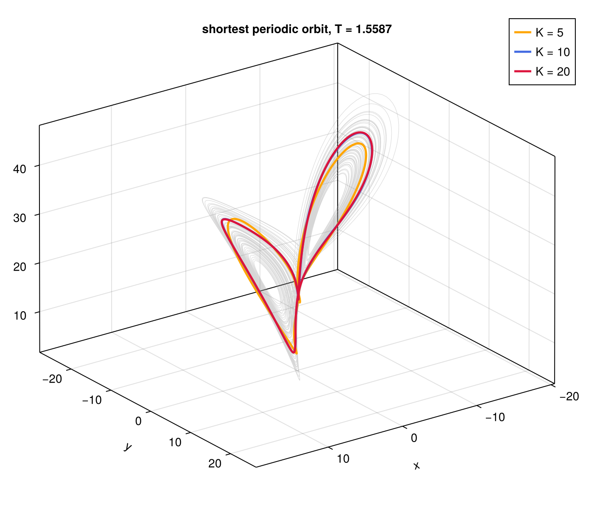
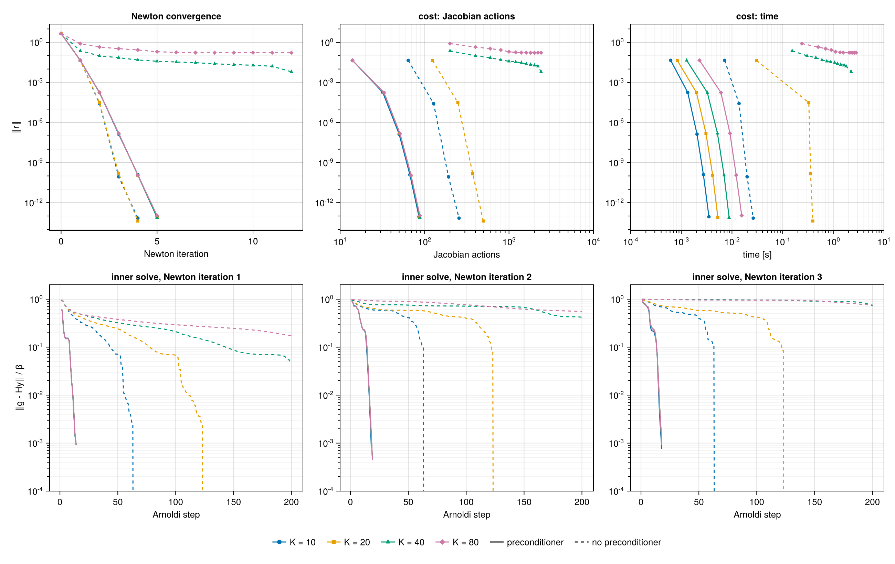
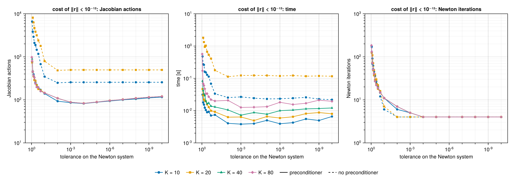
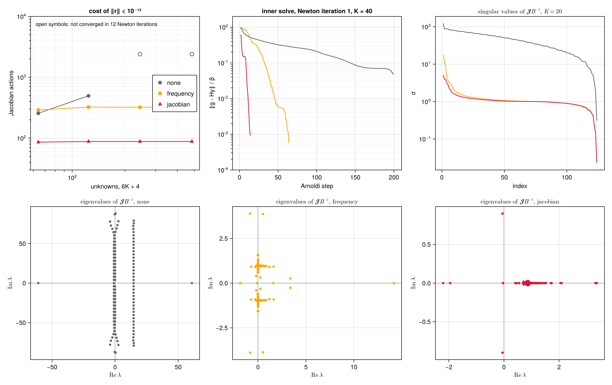

# Lorenz system

The Lorenz system is the smallest setting in which the space-time formulation can be studied in
full. Its orbits are smooth and its Jacobian can be formed and analysed as a dense matrix, yet the
time derivative alone already makes the space-time problem stiff. This page computes its shortest
periodic orbit, studies the convergence of the hookstep at increasing resolution, and compares
three preconditioners. The model is defined in `examples/lorenz/lorenz.jl`, and
`examples/lorenz/example.jl` converges the orbit. The scripts `convergence.jl` and
`preconditioners.jl` in `examples/lorenz/scripts/` produce the other figures.

## Problem

The Lorenz system

```math
\dot x = \sigma (y - x), \qquad \dot y = x(\rho - z) - y, \qquad \dot z = x y - \beta z , \tag{1}
```

with the standard parameters $\sigma = 10$, $\rho = 28$ and $\beta = 8/3$, has a chaotic attractor
densely filled with unstable periodic orbits. The shortest one winds once around each of the two
unstable fixed points and has period $T \approx 1.5587$. The system has no continuous symmetry, so
the orbits are periodic, $c = 0$. The unknowns are the state over one period and the log-frequency
$\rho_\omega = \log\omega$. On this page the symbol $\rho$ is kept for the Lorenz parameter.

## Discretisation

The state is expanded in $K$ Fourier modes in rescaled time,

```math
u(s) = \hat u_0 + 2\,\mathrm{Re} \sum_{n=1}^{K} \hat u_n\, e^{\mathrm{i} n s}, \qquad
u = (x, y, z) , \tag{2}
```

and a `LorenzField` stores the coefficients $\hat u_n$, $n = 0, \dots, K$. There are three real
coefficients for $n = 0$ and three complex ones for each $n \ge 1$. With the log-frequency, the
problem has

```math
N = 3(2K + 1) + 1 = 6K + 4 \tag{3}
```

real unknowns, that is 64, 124, 244 and 484 for $K = 10$, $20$, $40$ and $80$. The inner product is
the mean over $s$ of the products of the states, which on the coefficients reads

```math
\langle u, v\rangle = \hat u_0 \cdot \hat v_0 + 2\,\mathrm{Re} \sum_{n \ge 1} \overline{\hat u_n}
\cdot \hat v_n . \tag{4}
```

The derivative $\partial_s$ multiplies $\hat u_n$ by $\mathrm{i}\,n$ and is exactly skew-adjoint
in (4). The nonlinear terms are evaluated pseudo-spectrally. The coefficients are transformed to
$4K + 1$ equispaced points in $s$, which removes the aliasing of the quadratic products. The
right-hand side of (1), or its Jacobian $J(u)$, is applied point by point, and the result is
transformed back and truncated to $K$ modes. The truncation is the adjoint of the zero padding in
the inner product (4). Applying $J(u)^\top$ point by point therefore gives the exact adjoint of the
discrete linearised operator.

## Initial guess

A trajectory of (1) is integrated with a fourth-order Runge–Kutta scheme, with step $0.005$, for
100 time units after a transient of 20. The best near recurrence with period between 1.4 and 1.7
has a relative error $\lVert u(t_0 + T_0) - u(t_0)\rVert / \lVert u(t_0)\rVert = 0.002$ with
$T_0 = 1.5600$. The segment from $t_0$ is integrated again on the $4K + 1$ points of the grid,
and its coefficients form the initial orbit.

## The shortest orbit

The hookstep, with the block preconditioner described below, converges from this guess to
$\lVert r\rVert < 10^{-12}$ in 4 to 8 Newton iterations.

| $K$ | unknowns | Newton iterations | period $T$ | $T - T_{K=20}$ |
|---|---|---|---|---|
| 5 | 34 | 8 | 1.57674231 | $1.8 \times 10^{-2}$ |
| 10 | 64 | 5 | 1.55873614 | $8.4 \times 10^{-5}$ |
| 20 | 124 | 4 | 1.55865221 | — |

The period converges spectrally with $K$, as expected for a smooth orbit. With $K = 20$ it is
$T = 1.55865221$, in agreement with the value reported in the literature for this orbit (e.g.
Viswanath 2003).



*The shortest periodic orbit on the attractor (grey), with $K = 5$, $10$ and $20$ modes. The
curves for $K = 10$ and $20$ coincide. With $K = 5$ the orbit is visibly under-resolved.*

## Convergence of the hookstep

To study the solver close to the solution, the orbit converged with $K = 20$ is resampled to
$K = 10$, $20$, $40$ and $80$. Its log-frequency is perturbed by $0.01$ and its field by 1% on the
five lowest modes, with the same perturbation at every resolution. The perturbation of the field
matters. Perturbing the frequency alone gives a residual aligned with a single column of the
Jacobian, $\omega\,\partial_s u$, which any Krylov solver finds in two steps, and this hides the
difficulty of the problem. The hookstep is run with the Newton system solved to a relative residual
$\tau = 10^{-3}$, without and with the block preconditioner.



*Top, residual against the Newton iterations, the Jacobian actions and the computing time. Bottom,
relative residual of the Newton system after each Arnoldi step, for the first three Newton
iterations. Solid lines, block preconditioner. Dashed lines, none.*

| $K$ | unknowns | Jacobian actions, no preconditioner | Jacobian actions, preconditioner |
|---|---|---|---|
| 10 | 64 | 256 | 86 |
| 20 | 124 | 496 | 88 |
| 40 | 244 | 2400, not converged in 12 iterations | 88 |
| 80 | 484 | 2400, not converged in 12 iterations | 88 |

With the preconditioner, Newton converges in 5 iterations at every resolution, and each inner solve
reaches $10^{-3}$ in 15 to 20 Arnoldi steps. The cost does not depend on the number of unknowns.
Without it, every inner solve stalls on a plateau, with $\lVert g - Hy\rVert / \beta$ between
$10^{-1}$ and $10^{-2}$, until the Krylov space spans almost the whole problem. The residual then
drops in a single step, at an Arnoldi step equal to the number of unknowns. The cost of each Newton
iteration is therefore proportional to $N$, and from $K = 40$ on the Krylov spaces of 200 vectors
no longer suffice.

## Tolerance of the inner solve

The tolerance $\tau$ of the Newton system trades the cost of each Newton iteration against their
number. The figure below shows the cost of bringing $\lVert r\rVert$ below $10^{-12}$ for $\tau$
from $0.95$ to $10^{-10}$.



*Cost of $\lVert r\rVert < 10^{-12}$ in Jacobian actions, time and Newton iterations, against the
tolerance on the Newton system. Missing points did not converge within 200 Newton iterations.
Without preconditioner only $K = 10$ and $20$ are shown.*

With the preconditioner the cost has a broad minimum, about 83 Jacobian actions at
$\tau = 10^{-4}$, and is the same at every resolution. Tightening the tolerance further costs
little. Newton converges quadratically in 4 or 5 iterations whatever $\tau$, and each extra digit
of the inner solve costs one or two Arnoldi steps, because the preconditioned spectrum is clustered
and GMRES converges at a fast, steady rate. At $\tau = 10^{-10}$ the cost is about 118 actions, 40%
above the minimum. Loosening the tolerance is far more expensive. For $\tau \ge 0.5$ the Newton
steps are poor approximations of the exact ones, and the outer iteration converges only linearly,
at a rate set by $\tau$. It needs between 100 and 200 Newton iterations at $\tau = 0.95$. This is
the classical picture of inexact Newton methods (Dembo, Eisenstat & Steihaug 1982). The outer
convergence is linear with rate $\tau$, and a forcing term that is too small is wasted work once
the outer residual is dominated by the error of the linearisation.

Without preconditioner the picture is different. For $\tau \le 10^{-2}$ the cost is constant, 256
actions for $K = 10$ and 496 for $K = 20$. These are four Newton iterations, each with a Krylov
space that spans the whole problem, 64 or 124 vectors, because GMRES does not reduce the residual
before that point. The solve is then exact, and the tolerance makes no difference. For looser
tolerances the cost grows by more than an order of magnitude, up to about $8 \times 10^{3}$ actions
at $K = 20$. The plateau of the inner solve ends at relative residuals between $10^{-1}$ and
$10^{-2}$, so a loose tolerance stops GMRES early, on the plateau, with a poor step. The number of
Newton iterations is then the same as with the preconditioner, but each of them costs many more
actions. The time follows the same trends. At these sizes it is dominated by the dense linear
algebra of the hookstep rather than by the actions.

## Preconditioners

Three preconditioners are compared, all block diagonal over the modes. Each multiplies the three
coefficients of the mode $n$ by a $3 \times 3$ block $b_n$. They are built once, from the initial
guess of the search, whose frequency and field are $\omega_0$ and $u_0$, with temporal mean
$\hat u_0$. `LorenzPreconditioner(x; kind)` in `lorenz.jl` builds the last two.

| name | block $b_n$ on the mode $n$ | captures |
|---|---|---|
| none | $I$ | nothing |
| frequency | $(1 + \omega_0 \lvert n\rvert)\, I$ | the time derivative $\omega\,\partial_s$ |
| jacobian | $\mathrm{i}\,\omega_0 n\, I - J(\bar u)$ | the linear space-time operator about the mean state $\bar u = \hat u_0$ |

On the log-frequency all three divide by $\lVert \omega_0\,\partial_s u_0\rVert$. The jacobian
preconditioner, the default of `LorenzPreconditioner`, is the field block
$\mathcal{J}_u = \omega\,\partial_s - L$ of the Jacobian (see [Search by root finding](@ref)), with
$\omega$ frozen at $\omega_0$ and $L$ at the Jacobian of the mean state. The orbit oscillates
around $\bar u \approx (0, 0, 23.5)$, where $J(\bar u)$ has eigenvalues $-13.58$, $-2.67$ and
$2.58$.



*Top left, Jacobian actions to $\lVert r\rVert < 10^{-12}$ against the number of unknowns, with
$\tau = 10^{-3}$. Top centre, relative residual of the Newton system in the first Newton iteration,
$K = 40$. Top right, singular values of $\mathcal{J}\mathcal{B}^{-1}$ at the converged orbit,
$K = 20$. Bottom, eigenvalues of $\mathcal{J}\mathcal{B}^{-1}$, $K = 20$.*

| $K$ | none | frequency | jacobian |
|---|---|---|---|
| 10 | 256 | 290 | 86 |
| 20 | 496 | 324 | 88 |
| 40 | not converged | 322 | 88 |
| 80 | not converged | 322 | 88 |

The spectra explain the costs. Below, $\mu$ denotes an eigenvalue of $\mathcal{J}\mathcal{B}^{-1}$.

- Without preconditioner the eigenvalues of $\mathcal{J}$ lie on vertical lines in the complex
  plane, at $\mu \approx \mathrm{i}\,\omega n - \lambda_j(J(\bar u))$, with $\lambda_j(J(\bar u))$
  the eigenvalues of $J(\bar u)$. One line lies near $\mathrm{Re}\,\mu = 14$, from the eigenvalue
  $-13.58$ of $J(\bar u)$. Two lie close to the imaginary axis, from $-2.67$ and $2.58$, and extend
  to $\pm\,\omega K \approx \pm\, 80$ along it. GMRES cannot damp such a spectrum with a
  polynomial of low degree, and needs a Krylov space as large as the problem.
- The frequency preconditioner divides by $1 + \omega_0 |n|$ and maps $\mathrm{i}\,\omega n$ to
  $\mathrm{i}\,\omega n / (1 + \omega_0 |n|) \to \pm\,\mathrm{i}$. The eigenvalues gather in two
  clusters on the imaginary axis, at $\pm\,\mathrm{i}$, independently of $K$. The cost becomes
  independent of the resolution, about 320 Jacobian actions. Two clusters on opposite sides of the
  origin, though, require a polynomial that is small on both, and GMRES pays for it.
- The jacobian preconditioner inverts the linear space-time operator and maps its linear part to
  the identity. The eigenvalues gather in a single cluster near one, with a handful of outliers due
  to the variation of $J(u(s))$ along the orbit. GMRES damps the cluster and the outliers in 15 to
  20 steps, and the cost drops to about 88 Jacobian actions at every resolution.

The singular values tell the same story only in part. The frequency and jacobian preconditioners
have almost identical singular values, between $10^{-1}$ and $10$, and condition numbers of
$7.7 \times 10^{2}$ and $2.2 \times 10^{2}$, against $4.0 \times 10^{2}$ without preconditioner.
The condition number does not predict the cost. The location and clustering of the eigenvalues do,
as expected for GMRES (see [Preconditioning](@ref)).

## References

- R. S. Dembo, S. C. Eisenstat and T. Steihaug, *Inexact Newton methods*, SIAM J. Numer. Anal. 19,
  400–408 (1982).
- D. Viswanath, *Symbolic dynamics and periodic orbits of the Lorenz attractor*, Nonlinearity 16,
  1035–1056 (2003).
