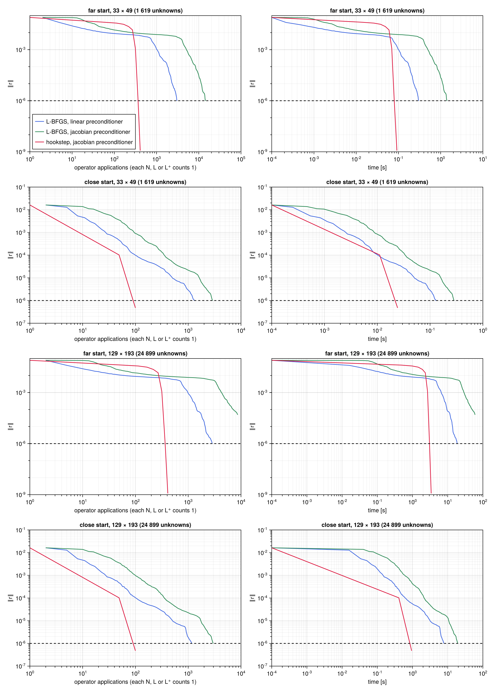
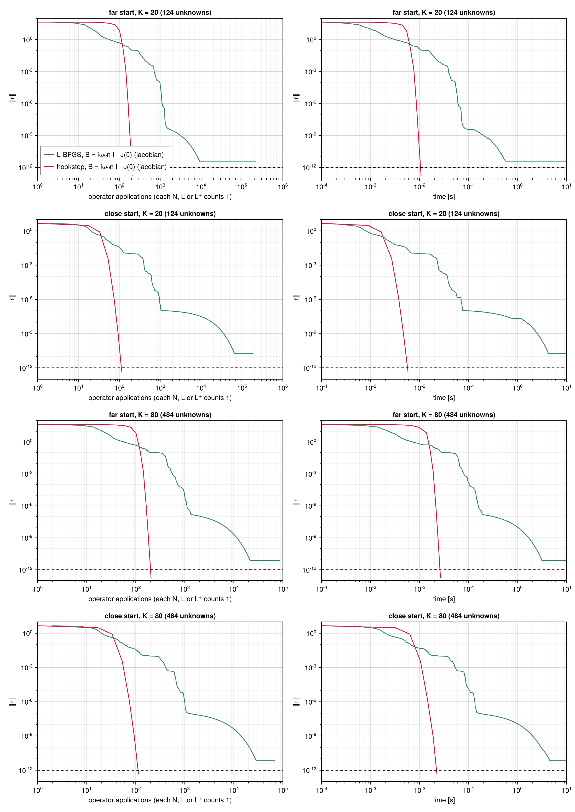
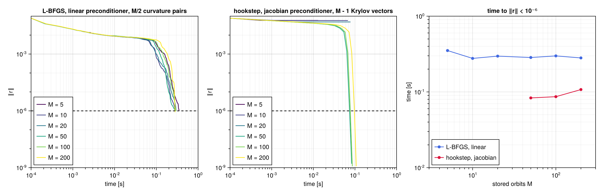
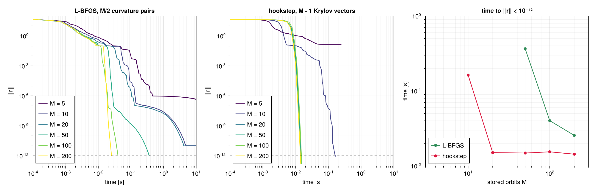

# L-BFGS against the hookstep

The two methods of the package solve the same problem in different ways. [`LBFGS`](@ref) minimises
$R = \tfrac12\lVert r\rVert^2$ with gradients, and [`NewtonHookstep`](@ref) solves $r = 0$ with
Jacobian actions. A comparison by iterations would mislead, since a Newton iteration contains a
whole Krylov solve. This page compares the methods at equal cost, on two examples, with the
preconditioner that captures the whole linear space-time operator. It also studies how the methods
behave when the memory available for stored orbits is limited. The scripts are
`examples/lorenz/scripts/methods.jl` and `examples/kuramoto_sivashinsky/scripts/methods.jl`.

## Measuring the cost

### Operator applications

The cost of a search is dominated by the operators of the system, each of which acts on a whole
space-time field. The figures count *operator applications*. Every application of the nonlinear
operator $N$, of the linearised operator $L$ or of the adjoint operator $L^+$ counts as one.
Table 1 lists the applications of each operation of the two methods.

| operation | operators | where |
|---|---|---|
| residual $r$ | one $N$ | every trial point of the L-BFGS line search and of the trust region, and the right-hand side of every Newton system |
| gradient $\nabla R$ | one $N$ and one $L^+$ | every accepted L-BFGS iterate |
| Jacobian action $\mathcal{J}\,\delta p$ | one $L$ | every Arnoldi step of the hookstep |

*Table 1. Operator applications of the operations of the two methods.*

An L-BFGS iteration thus costs at least three applications, one $N$ and one $L^+$ for the
gradient and one $N$ for the first trial point of the line search. A Newton iteration with a
Krylov space of $n$ vectors costs $n$ applications of $L$ and two or more of $N$. Derivatives,
preconditioner applications, inner products and the small dense problems of the two methods are not
counted, but they are included in the wall-clock time. The wall-clock time excludes compilation.
Each method is run once briefly before it is timed, and a search that converges is timed three
times, with the fastest run kept.

### Cost of the three operators

Counting the three operators alike is fair only if they cost about the same. This depends on their
implementation, not on the methods. The scripts first measure them, as the best of five batches
after compilation (Table 2).

| system | $N$ | $L$ | $L^+$ | residual | gradient | Jacobian action | $\mathcal{B}^{-1}$ |
|---|---|---|---|---|---|---|---|
| Lorenz, $K = 40$ | 46.9 | 44.8 | 47.4 | 49.9 | 126.6 | 48.9 | 5.0 |
| KS, $33 \times 49$ | 16.8 | 16.9 | 22.8 | 45.3 | 127.4 | 71.8 | 14.3 |
| KS, $129 \times 193$ | 1 311 | 1 315 | 1 768 | 3 168 | 9 852 | 5 903 | 922 |

*Table 2. Times in μs per call. Residual, gradient and Jacobian action are the functions of the
package, which add the derivatives, the inner products and, for the gradient, a residual and a
linearisation to the operators.*

The three operators cost about the same. The adjoint operator of Kuramoto–Sivashinsky costs 35% more
than the other two, since it needs four FFTs against three. A gradient costs 2.5 to 3.1 residuals,
since it includes a residual, a linearisation and an adjoint operator. A Jacobian action costs 1 to
2 residuals, since it adds to the linearised operator the derivatives of the step and of the orbit,
which for Kuramoto–Sivashinsky cost two FFTs each.

## The two preconditioners of L-BFGS

With a preconditioner $\mathcal{B}$, L-BFGS works in the metric
$\langle p, q\rangle_{\mathcal{B}} = \langle \mathcal{B}p, \mathcal{B}q\rangle$. Its first direction
is $-M^{-1}\nabla R$ with $M = \mathcal{B}^+\mathcal{B}$, and its initial inverse Hessian is
$\theta M^{-1}$ (see [Preconditioning](@ref)). Equivalently, it runs plain L-BFGS on the variables
$q = \mathcal{B}p$. Its speed is then set by the singular values of $\mathcal{J}\mathcal{B}^{-1}$,
and that of GMRES by the eigenvalues of the same operator. The two can be very different.

### L-BFGS sees the singular values

Near a solution the residual is nearly linear in $q$,
$r(q + \delta q) \approx r + \mathcal{J}\mathcal{B}^{-1}\,\delta q$, so that $R$ is nearly a
quadratic,

```math
R(q + \delta q) \approx \tfrac12 \lVert r + \mathcal{J}\mathcal{B}^{-1}\,\delta q\rVert^2 ,
\qquad
\nabla^2 R \approx (\mathcal{J}\mathcal{B}^{-1})^+ (\mathcal{J}\mathcal{B}^{-1}) ,
```

with the Gauss–Newton Hessian, exact at a solution, where $r = 0$. The eigenvalues of this Hessian
are the squares $\sigma_i^2$ of the singular values $\sigma_i$ of $\mathcal{J}\mathcal{B}^{-1}$,
and its condition number is $\kappa^2$, with $\kappa = \sigma_{\max}/\sigma_{\min}$ the condition
number of $\mathcal{J}\mathcal{B}^{-1}$. Two limits bracket the behaviour of L-BFGS on such a
quadratic. With exact line searches, BFGS generates the iterates of the conjugate gradient method
(Nazareth 1979), here conjugate gradients on the normal equations of the Newton system. The residual
then decreases at least as fast as $2\big((\kappa - 1)/(\kappa + 1)\big)^k$ after $k$ iterations,
by about $1 - 2/\kappa$ per iteration (Nocedal & Wright 2006, §5.1). Steepest descent, at the
other extreme, decreases it by $(\kappa^2 - 1)/(\kappa^2 + 1) \approx 1 - 2/\kappa^2$ per
iteration at worst (Nocedal & Wright 2006, §3.3). With a few curvature pairs and inexact line
searches L-BFGS lies between the two. It converges linearly, at a rate that degrades as $\kappa$
grows (Liu & Nocedal 1989).

### GMRES sees the eigenvalues

GMRES minimises the residual of the Newton system over the Krylov space of
$\mathcal{J}\mathcal{B}^{-1}$ itself, with the polynomials $p(\mathcal{J}\mathcal{B}^{-1})$ that
equal one at the origin. It converges fast when the eigenvalues of $\mathcal{J}\mathcal{B}^{-1}$
are clustered away from the origin, whatever its singular values (Saad 2003, ch. 6). Either kind of
method can beat the other by a large factor (Nachtigal, Reddy & Trefethen 1992). Their simplest
example is the cyclic shift $S$, which maps the unit vector $e_j$ to $e_{j+1}$ and $e_N$ to $e_1$.
$S$ is orthogonal, so its singular values are all one, and conjugate gradients on the normal
equations converge in one step. Its eigenvalues, though, are the $N$ roots of unity, spread around
the origin, and GMRES from $e_1$ makes no progress for $N - 1$ steps.

### The two preconditioners for Kuramoto–Sivashinsky

Two preconditioners are compared. Both are built on the eigenvalues
$\lambda_{kn} = \mathrm{i}(\omega_0 n - c_0 k) + k^4 - k^2$ of the linear part of
$\mathcal{J}_u$, the field block of the Jacobian, with $\omega_0$ and $c_0$ the frequency and the
drift speed of the initial guess (see
[Preconditioners](kuramoto_sivashinsky.md#Preconditioners)). Each multiplies the Fourier mode
$(k, n)$ by a number $b_{kn}$.

- The linear preconditioner, $b_{kn} = 1 + |\lambda_{kn}|$, is real and positive. It rescales
  each Fourier mode by the size of the operator, so that L-BFGS works in the metric that multiplies
  the mode by $(1 + |\lambda_{kn}|)^2$.
- The jacobian preconditioner, $b_{kn} = \lambda_{kn}$, is complex. It is the operator itself,
  with metric multipliers $|\lambda_{kn}|^2$.

For the hookstep the jacobian preconditioner is three times cheaper, because it clusters the
eigenvalues of $\mathcal{J}\mathcal{B}^{-1}$ around one. For L-BFGS it is worse, because of the
singular values. On the linearly unstable wavenumbers $0 < k < 1$ at $n = 0$, $|\lambda_{kn}|$ is
small, between $0.075$ and $0.22$, while the advection by the orbit, which the preconditioner
ignores, is not. Dividing by $\lambda_{kn}$ amplifies the advection, and
$\mathcal{J}\mathcal{B}^{-1}$ has singular values up to about 17, against 1.7 with the linear
preconditioner. The smallest singular values, about $10^{-2}$, are similar for both. Then
$\kappa = 1.6 \times 10^{3}$ with the jacobian preconditioner against $2.2 \times 10^{2}$ with
the linear one. The ratio of seven enters the number of iterations linearly for conjugate gradients
and quadratically for steepest descent. For the Lorenz system the jacobian preconditioner, the
block $b_n = \mathrm{i}\,\omega_0 n\,I - J(\bar u)$ on the mode $n$, is used for both methods.

## Kuramoto–Sivashinsky

There are two starts, each on the base grid and on a grid refined four times. The *far* start is
the near recurrence of the
[first search](kuramoto_sivashinsky.md#The-shortest-pre-periodic-orbit), with
$\lVert r\rVert = 7.8 \times 10^{-2}$. The *close* start is the converged orbit perturbed as in the
convergence study, with $\lVert r\rVert = 1.6 \times 10^{-2}$. The searches stop at
$\lVert r\rVert < 10^{-6}$, a residual small enough to identify the orbit, or after 20 s on the
base grid and 60 s on the fine grid. L-BFGS keeps 10 curvature pairs, and the hookstep up to 150
Krylov vectors.



*Residual against the operator applications (left) and the wall-clock time (right), for the four
searches. The dashed line marks the tolerance $10^{-6}$.*

| start, grid | L-BFGS, linear | L-BFGS, jacobian | hookstep, jacobian |
|---|---|---|---|
| far, $33 \times 49$ | 3 027 | 14 451 | 411 |
| close, $33 \times 49$ | 1 306 | 2 874 | 100 |
| far, $129 \times 193$ | 2 850 | not reached ($4.9 \times 10^{-5}$ after 60 s) | 411 |
| close, $129 \times 193$ | 1 162 | 2 981 | 100 |

*Table 3. Kuramoto–Sivashinsky, operator applications to $\lVert r\rVert < 10^{-6}$.*

Counted in operator applications the hookstep is the cheaper method in all four searches (Table 3).
It is about seven times cheaper than the better L-BFGS from the far start, and twelve times from
the close one. For both methods the count does not depend on the resolution. The two grids differ by
at most 11%, the mark of a preconditioner that captures the stiffness of the problem at every
scale. In wall-clock time the advantage of the hookstep is smaller on the base grid, 0.09 s against
0.30 s from the far start. There the operators are cheap, and the dense linear algebra of the
hookstep, the Hessenberg least-squares problems and the orthogonalisation of the Krylov basis, is
not negligible. On the fine grid, where the operators dominate, the ratio of times approaches that
of the counts, 3.4 s against 18.6 s. The times, measured on a laptop (Apple M5), vary by up to 20%
from one run to another.

The two preconditioners of L-BFGS behave very differently. With the linear one L-BFGS converges at a
steady rate. With the jacobian one it is slower from the close start, by a factor of 2.2 to 2.6.
From the far start it reaches $10^{-3}$ four to five times later. On the base grid it reaches
$10^{-6}$ after $1.4 \times 10^{4}$ applications, nearly five times later, and then almost stops.
Continued beyond the tolerance, the residual decreases from $6.7 \times 10^{-7}$ to
$5.8 \times 10^{-7}$ between iterations $10^{4}$ and $2 \times 10^{4}$. The search does not stop.
Each line search accepts the full step, and the residual decreases by a factor of about
$1 - 1.5 \times 10^{-5}$ per iteration, the linear convergence of a quasi-Newton method on a very
ill-conditioned problem. With $\kappa = 1.6 \times 10^{3}$, conjugate gradients would decrease the
residual by about $1 - 2/\kappa \approx 1 - 1.3 \times 10^{-3}$ per iteration, and steepest descent
by $1 - 2/\kappa^2 \approx 1 - 7.8 \times 10^{-7}$ at worst. With ten curvature pairs L-BFGS is
closer to steepest descent. The singular values of $\mathcal{J}\mathcal{B}^{-1}$ span $10^{-2}$ to
17 with the jacobian preconditioner, against $10^{-2}$ to 1.7 with the linear one. The smallest are
similar, and the largest come from the linearly unstable wavenumbers, where $|\lambda_{kn}|$ is
small. The steps of a gradient-based method are limited by the largest curvature, so the components
of small curvature converge much more slowly with the jacobian preconditioner. For steepest descent
they converge $(17/1.7)^2 \approx 100$ times more slowly. The residual left is concentrated, half of
its energy, in the unstable wavenumbers $m = 1, 2$ at $n = 0$.

The level of the plateau is sensitive to rounding. A start that differs from this one only at the
level of rounding stalls at $1.0 \times 10^{-6}$, just above the tolerance. On the fine grid the
time limit stops the search at $4.9 \times 10^{-5}$, after fewer iterations than the base grid
needs.

## Lorenz system

There are two starts, each with $K = 20$ and $K = 80$ modes. The *far* start is the converged
orbit perturbed by 10% on its five lowest modes and by $0.05$ in the log-frequency, with
$\lVert r\rVert = 45$. The *close* start is perturbed by 1% and $0.01$, as in the convergence study,
with $\lVert r\rVert = 4.6$. The searches stop at $\lVert r\rVert < 10^{-12}$ or after 10 s. L-BFGS
keeps 10 curvature pairs, and the hookstep up to 100 Krylov vectors.



*Residual against the operator applications (left) and the wall-clock time (right), for the four
searches. The dashed line marks the tolerance $10^{-12}$.*

| start, $K$ | L-BFGS, to $10^{-3}$ | L-BFGS, to $10^{-6}$ | L-BFGS, to $10^{-12}$ | hookstep, to $10^{-12}$ |
|---|---|---|---|---|
| far, 20 | 712 | 1 118 | not reached | 206 |
| close, 20 | 402 | 956 | not reached | 114 |
| far, 80 | 561 | 1 109 | not reached | 206 |
| close, 80 | 408 | 1 002 | not reached | 114 |

*Table 4. Lorenz, operator applications to each residual level. The hookstep jumps from above
$10^{-3}$ to below $10^{-6}$ in a single Newton iteration, after 164 applications from the far
start and 74 to 94 from the close one.*

The picture is the same as for Kuramoto–Sivashinsky, here with the same preconditioner for both
methods (Table 4). The hookstep reaches $10^{-12}$ with five to ten times fewer applications than
L-BFGS needs for $10^{-6}$, at a cost independent of the number of modes. L-BFGS does not reach
$10^{-12}$ within 10 s. It stalls between $4 \times 10^{-12}$ and $2 \times 10^{-11}$, where the
objective $R = \tfrac12\lVert r\rVert^2 \approx 10^{-23}$ is known only to the accuracy of the
rounding errors in $r$, of order $10^{-13}$ for fields of size $10$. The Armijo test is then decided
by rounding, the line search backtracks, and an iteration costs up to 20 residual evaluations
instead of one. The hookstep is not affected, and crosses this range in one or two Newton steps.

## Limited memory

Both methods store orbits. L-BFGS stores two per curvature pair, $s_k$ and $y_k$, and the hookstep
one per Krylov vector. For a large problem, such as a flow on a fine grid, this memory may limit the
search more than the arithmetic does. The figures below repeat the far search with a budget of $M$
stored orbits, for $M$ from 5 to 200. L-BFGS keeps $M/2$ curvature pairs, and the hookstep a Krylov
space of at most $M - 1$ vectors. The few work orbits of each method, about six, are not counted.



*Kuramoto–Sivashinsky, far start, base grid, tolerance $10^{-6}$. Left and centre, residual against
time for each budget. Right, time to reach the tolerance. Missing points did not reach it.*



*Lorenz, far start, $K = 40$, tolerance $10^{-12}$.*

For Kuramoto–Sivashinsky, L-BFGS reaches $10^{-6}$ with every budget, in 0.28 to 0.35 s. Fewer
curvature pairs cost more iterations, from 418 with 100 pairs to 1 329 with 2, but never failure.
The hookstep needs a Krylov space large enough to solve the preconditioned Newton systems, about 45
to 55 vectors here. With $M \ge 50$ it converges in 8 Newton iterations whatever the budget. With
$M \le 20$ the inner solves stop far from their tolerance and the steps are poor. The trust region
then shrinks until it collapses, and the search stops at $\lVert r\rVert \approx 5 \times 10^{-2}$.
For Lorenz the threshold of the hookstep is lower, 15 to 20 vectors. With $M = 10$ it still
converges, in 205 Newton iterations and 0.16 s, and with $M \ge 20$ in 10. L-BFGS needs at least
25 pairs, $M = 50$, to reach $10^{-12}$ within 10 s, and stalls at $5 \times 10^{-7}$ with 2.

The two methods respond to memory in opposite ways. The cost of the hookstep does not depend on the
budget above a threshold, the Krylov dimension that the preconditioned Newton systems need, and the
method fails below it. L-BFGS degrades gradually and never fails, but it is slower whenever the
budget allows the hookstep to work. A good preconditioner lowers the threshold of the hookstep.
Without one the threshold is close to the number of unknowns, as the convergence studies of the two
examples show, and only L-BFGS remains practical for a large problem.

## Conclusions

- With a preconditioner that captures the linear space-time operator, the hookstep is the faster
  method, from far as well as from close initial guesses. It needs five to twelve times fewer
  operator applications than L-BFGS, at a cost independent of the resolution, and it reaches the
  level of rounding errors, which L-BFGS does not.
- The preconditioner should be chosen for each method. The hookstep gains most from the operator
  itself, phase included. L-BFGS gains most from a positive operator bounded below, which gives a
  well-balanced metric. For L-BFGS the condition number of $\mathcal{J}\mathcal{B}^{-1}$ matters,
  and for the hookstep the clustering of its eigenvalues.
- L-BFGS is the method of choice when memory is scarce. Below the Krylov dimension that the Newton
  systems need the hookstep fails, while L-BFGS works with a handful of stored orbits.
- Counting operator applications is meaningful only if the operators cost about the same, which
  should be checked for each system, as in Table 2.

## References

- D. C. Liu and J. Nocedal, *On the limited memory BFGS method for large scale optimization*, Math.
  Program. 45, 503–528 (1989).
- N. M. Nachtigal, S. C. Reddy and L. N. Trefethen, *How fast are nonsymmetric matrix iterations?*,
  SIAM J. Matrix Anal. Appl. 13, 778–795 (1992).
- L. Nazareth, *A relationship between the BFGS and conjugate gradient algorithms and its
  implications for new algorithms*, SIAM J. Numer. Anal. 16, 794–800 (1979).
- J. Nocedal and S. J. Wright, *Numerical Optimization*, 2nd ed., Springer (2006).
- Y. Saad, *Iterative Methods for Sparse Linear Systems*, 2nd ed., SIAM (2003).
