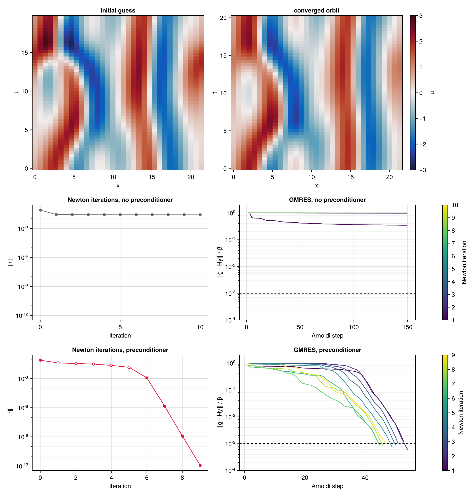

# ReSolver.jl

*Space-time search for periodic and relative periodic orbits of dynamical systems.*

Developed by Davide Lasagna, University of Southampton.

Many dynamical systems, from low-dimensional models to turbulent flows, organise their chaotic
dynamics around unstable periodic orbits. These are solutions that repeat exactly after a period
$T$, or that repeat up to a translation along a direction of symmetry, the *relative* periodic
orbits. They are hard to find because they are unstable. A shooting method integrates forward in
time from a nearby state, and every error grows exponentially over the period. The longer or the
more unstable the orbit, the worse the problem.

ReSolver avoids time integration altogether. Consider a system

```math
\partial_t u = N(u) ,
```

with $u$ a function of time and of any number of spatial coordinates, possibly equivariant under
translations along some of them. A relative periodic orbit of period $T$ repeats after $T$ up to
shifts $\ell_i$ along these directions, $u(x_i + \ell_i, t + T) = u(x_i, t)$. In the frame moving
with the drift speeds $c_i = -\ell_i/T$ it is periodic, and a periodic orbit is the case without
drift. ReSolver treats the whole orbit as a single unknown. This is the field over one period,
written in the rescaled time $s = \omega t \in [0, 2\pi)$, together with the frequency
$\omega = 2\pi/T$ and the drift speeds $c_i$. An orbit is a zero of the space-time residual

```math
r(u, \omega, c) = \omega\,\partial_s u - \sum_i c_i\,\partial_i u - N(u) ,
```

which measures how far the candidate field is from satisfying the equation, at every point in space
and rescaled time. The package has two methods to drive this residual to zero.

| method | solves | uses | best |
|---|---|---|---|
| [`LBFGS`](@ref) | $\min \tfrac12\lVert r\rVert^2$ | gradient from the adjoint operator, line search | far from a solution |
| [`NewtonHookstep`](@ref) | $r = 0$ | Jacobian from the linearised operator or finite differences, Krylov space, trust region | close to a solution |

## Features

- The search uses only a few functions supplied by the user. These are the nonlinear operator, its
  linearisation and adjoint, and the derivatives in rescaled time and along the drift directions.
  The same code serves an ODE such as the Lorenz system, a PDE such as the Kuramoto–Sivashinsky
  equation, or a flow solver, in any discretisation.
- The hookstep can do without the adjoint operator, and without the linearised operator too. A
  Jacobian-free [`System`](@ref) applies the linearised operator by forward or central finite
  differences of the nonlinear operator, while the residual stays exact.
- Relative periodic orbits are periodic orbits in a drifting frame. The drift speed along each
  chosen direction of translational symmetry is an unknown of the search, with a phase condition
  that keeps the Newton system square. An orbit that closes up to a shift $\ell_i$ has the drift
  speed $c_i = -\ell_i/T$. A shift by a discrete symmetry can be built into the field type, as the
  keyword `yshift` of the Kolmogorov flow example does for a shift across the force.
- A projection, given as one function, restricts the search to the fields fixed by a symmetry of
  the problem. The package applies it to the initial orbit and to every residual, gradient,
  Jacobian action and application of the preconditioner. The orbit then keeps the symmetry to
  rounding at every iteration, and the operators need no change.
- [`LBFGS`](@ref) minimises $\tfrac12\lVert r\rVert^2$ in the metric defined by the
  preconditioner, with gradients from the adjoint operator. With `memory=0` it is gradient descent
  in that metric, with the step of Barzilai and Borwein.
- [`NewtonHookstep`](@ref) solves $r = 0$ by a matrix-free Newton–Krylov method. Each Newton
  system, with its phase conditions, is solved in a Krylov space with right preconditioning. The
  step is the hookstep, the minimiser of the linear model within a trust region. The Krylov space
  stops growing once the Newton system is solved to a relative tolerance.
- With `flexible=true` the hookstep uses flexible GMRES. The preconditioner may then change from
  one Arnoldi step to the next, as it does when an inner iterative solver applies it.
- A preconditioner is any type that extends two functions, `precondition!` and
  `precondition_adjoint!`. The examples have diagonal and block-diagonal preconditioners in
  Fourier space, and the factorised space-time preconditioner of the Kolmogorov flow example, which
  solves its spatial blocks by inner GMRES iterations.
- A preconditioner that depends on the orbit can follow the search. The hookstep calls
  `relinearise!` at the start of every Newton iteration, which rebuilds it about the current orbit.
- A [`Trace`](@ref) records the history of a search. It keeps the residual, the parameters, the
  time, the evaluations of the operators and the convergence of every inner GMRES solve. For the
  hookstep it also keeps the trust-region radius, the step length, the ratio of actual to predicted
  reduction and the number of rejected steps.
- The search only broadcasts and takes inner products of the fields. A model written with GPU
  arrays runs the whole search on the GPU, in single or double precision, as the Kolmogorov flow
  example does.
- The package depends only on the Julia standard library. L-BFGS and the Arnoldi iteration are
  short local implementations.
- The examples cover the Lorenz system, the Kuramoto–Sivashinsky equation in the full space and in
  the odd subspace, a comparison of the two methods, and two-dimensional Kolmogorov flow (see
  [Examples](#Examples) below).

## A first example

The Kuramoto–Sivashinsky equation

```math
\partial_t u = -u\,\partial_x u - \partial_x^2 u - \partial_x^4 u , \qquad x \in [0, L) ,
```

with periodic boundary conditions, $u(x + L, t) = u(x, t)$, is the simplest partial differential
equation with spatio-temporal chaos. It was derived by Kuramoto & Tsuzuki (1976), for the phase of
oscillations in reaction–diffusion systems, and independently by Sivashinsky (1977), for the
instability of laminar flame fronts. It also describes thin films flowing down an inclined plane.
The second-derivative term, a negative diffusion, destabilises the large scales. The
fourth-derivative term damps the small ones, and the nonlinear term transfers energy between them.
On a domain of length $L = 22$ the dynamics is chaotic but low-dimensional. Its equilibria,
travelling waves and relative periodic orbits were mapped in detail by Cvitanović, Davidchack &
Siminos (2010). The equation is equivariant under translations $u(x) \to u(x + \ell)$, so its
recurrent solutions are relative periodic orbits, which repeat after a period $T$ up to a shift
$\ell$.

Here an orbit is searched for from a near recurrence of a chaotic trajectory, with $u$ expanded in
Fourier modes in space and rescaled time. The Newton–Krylov hookstep converges it with a
preconditioner built from the linear part of the equation. The search finds the shortest
pre-periodic orbit of the system, traversed twice. The page [Kuramoto–Sivashinsky equation](@ref)
has the details and the full analysis. Run the code from the root of the repository, in the
environment of the examples, `julia --project=examples`.

```julia
using Random
using ReSolver
include("examples/kuramoto_sivashinsky/ks.jl")      # fields, operators, preconditioners

Random.seed!(1)
g = KSGrid(22, 33, 49)                              # L = 22, 33 points in x, 49 instants in s

# ---- a chaotic trajectory and its best near recurrence ----
u₀  = 0.1 .* randn(g.Nx)
u₀ .-= sum(u₀) / g.Nx                               # zero mean, which the equation conserves
U   = integrate(u₀, g, 0.05, 4000; every=4000)      # transient
U   = integrate(U[:, end], g, 0.05, 8000; every=5)  # 400 time units, a state every 0.25

e, i, m, ℓ = recurrence(U, g, 0.25, (12, 20))
x          = initial_orbit(U, g, 0.25, i, m, ℓ)     # Orbit: field, [log ω, c]

# ---- the system on the fields of zero mean, and the search ----
F = System(KSNonlinear(g), KSLinearised(g), KSLinearised(g; adjoint=true), dds!, x;
           linearise!, ddi=(ddx!,), B=KSPreconditioner(x; kind=:jacobian), project=demean!)

solve!(x, F, NewtonHookstep(maxiter=50, krylov_dim=150, Δ=0.1, Δmax=10))

2π / ReSolver.frequency(x)                          # the period, 20.5057
```



*Top, the initial guess and the converged orbit over one period, in the fixed frame. Middle and
bottom, the same search without and with the preconditioner. Left, the residual against the Newton
iterations, with hooksteps on the boundary of the trust region as open symbols and full Newton steps
filled. Right, the relative residual of the GMRES solution of the Newton system against the Arnoldi
steps, one curve per Newton iteration, with the tolerance $10^{-3}$ dashed.*

Without the preconditioner GMRES makes almost no progress on any Newton system. After 150 Arnoldi
steps the relative residual is still between $0.3$ and $1$, the Newton steps are poor, and the
residual of the orbit stalls. With the preconditioner every Newton system is solved to $10^{-3}$ in
45 to 55 Arnoldi steps. The first five iterations are hooksteps. Far from the solution the Newton
step is longer than the trust region, and only part of it is taken. From the sixth iteration on the
full Newton step is taken, and the residual drops from $10^{-3}$ to $10^{-12}$ in three iterations.
The search costs 441 Jacobian actions.

On the grid of $33 \times 49$ points in space and rescaled time the orbit has $1\,617$ field
values. With the log-frequency and the drift speed there are $N = 1\,619$ real unknowns. The 441
Jacobian actions of the search are about a quarter of an action per unknown, and each action costs
a few FFTs of the space-time grid. Newton's method with a direct solver would instead form the
Jacobian at every iteration, by $N$ actions, and factorise the dense $1\,619 \times 1\,619$ matrix
of the spectral discretisation, at a cost of about $2N^3/3 \approx 2.8 \times 10^{9}$ operations.
Finite differences in time make the Jacobian banded and the factorisation much cheaper. Its cost
still grows as the cube of the number of spatial unknowns, while the number of Jacobian actions of
the preconditioned Krylov solver does not grow with the resolution. The section
[Cost compared with direct solvers](@ref) gives an estimate.

### References

- Y. Kuramoto and T. Tsuzuki, *Persistent propagation of concentration waves in dissipative media
  far from thermal equilibrium*, Prog. Theor. Phys. 55, 356–369 (1976).
- G. I. Sivashinsky, *Nonlinear analysis of hydrodynamic instability in laminar flames — I.
  Derivation of basic equations*, Acta Astronaut. 4, 1177–1206 (1977).
- P. Cvitanović, R. L. Davidchack and E. Siminos, *On the state space geometry of the
  Kuramoto–Sivashinsky flow in a periodic domain*, SIAM J. Appl. Dyn. Syst. 9, 1–33 (2010).

## Examples

Each example has a model file in `examples/`, which defines the field type, the operators and the
preconditioners of one system, and a page of the documentation. The scripts that produce the
figures of the pages are in `examples/*/scripts/`.

- [Lorenz system](examples/lorenz.md). The shortest periodic orbit, a Jacobian small enough to be
  formed, and three preconditioners.
- [Kuramoto–Sivashinsky equation](examples/kuramoto_sivashinsky.md). Relative periodic orbits on
  $L = 22$, the convergence of the hookstep on grids of up to $10^5$ unknowns, and five
  preconditioners.
- [Kuramoto–Sivashinsky in the odd subspace](examples/ks_symmetric.md). A search restricted to a
  symmetric subspace.
- [L-BFGS against the hookstep](examples/methods.md). The two methods compared on the same orbits.
- [Kolmogorov flow](examples/kolmogorov_flow.md). Relative periodic orbits of two-dimensional
  Kolmogorov flow at $Re = 40$, on a CPU or a GPU, with the factorised preconditioner of the paper
  cited below.

## References

ReSolver builds on the variational method of Cvitanović & Lan (2003) and Lan & Cvitanović (2004),
who first posed the search for a periodic orbit as the deformation of a closed loop until it
satisfies the equations of motion. Farazmand (2016) found invariant solutions of the Navier–Stokes
equations by adjoint-based descent. Azimi, Ashtari & Schneider (2022) turned this into a
variational method for the periodic orbits of high-dimensional chaotic systems. Parker & Schneider
(2022) applied variational methods to the periodic orbits of the incompressible Navier–Stokes
equations, and Ashtari & Schneider (2023a, 2023b) to three-dimensional shear flows and to
connecting orbits. The Newton–Krylov hookstep follows Viswanath (2007), and the Jacobian-free
option follows Knoll & Keyes (2004). The Kolmogorov flow example is set as in Chandler & Kerswell
(2013).

- P. Cvitanović and Y. Lan, *Turbulent fields and their recurrences*, in Correlations and Fluctuations in QCD, World Scientific, 313–325 (2003). [doi:10.1142/9789812704641_0032](https://doi.org/10.1142/9789812704641_0032)
- Y. Lan and P. Cvitanović, *Variational method for finding periodic orbits in a general flow*, Phys. Rev. E 69, 016217 (2004). [doi:10.1103/PhysRevE.69.016217](https://doi.org/10.1103/PhysRevE.69.016217)
- M. Farazmand, *An adjoint-based approach for finding invariant solutions of Navier–Stokes equations*, J. Fluid Mech. 795, 278–312 (2016). [doi:10.1017/jfm.2016.203](https://doi.org/10.1017/jfm.2016.203)
- S. Azimi, O. Ashtari and T. M. Schneider, *Constructing periodic orbits of high-dimensional chaotic systems by an adjoint-based variational method*, Phys. Rev. E 105, 014217 (2022). [doi:10.1103/PhysRevE.105.014217](https://doi.org/10.1103/PhysRevE.105.014217)
- J. P. Parker and T. M. Schneider, *Variational methods for finding periodic orbits in the incompressible Navier–Stokes equations*, J. Fluid Mech. 941, A17 (2022). [doi:10.1017/jfm.2022.299](https://doi.org/10.1017/jfm.2022.299)
- O. Ashtari and T. M. Schneider, *Identifying invariant solutions of wall-bounded three-dimensional shear flows using robust adjoint-based variational techniques*, J. Fluid Mech. 977, A7 (2023a). [doi:10.1017/jfm.2023.927](https://doi.org/10.1017/jfm.2023.927)
- O. Ashtari and T. M. Schneider, *Jacobian-free variational method for computing connecting orbits in nonlinear dynamical systems*, Chaos 33, 073134 (2023b). [doi:10.1063/5.0143923](https://doi.org/10.1063/5.0143923)
- D. Viswanath, *Recurrent motions within plane Couette turbulence*, J. Fluid Mech. 580, 339–358 (2007). [doi:10.1017/S0022112007005459](https://doi.org/10.1017/S0022112007005459)
- D. A. Knoll and D. E. Keyes, *Jacobian-free Newton–Krylov methods. A survey of approaches and applications*, J. Comput. Phys. 193, 357–397 (2004). [doi:10.1016/j.jcp.2003.08.010](https://doi.org/10.1016/j.jcp.2003.08.010)
- G. J. Chandler and R. R. Kerswell, *Invariant recurrent solutions embedded in a turbulent two-dimensional Kolmogorov flow*, J. Fluid Mech. 722, 554–595 (2013). [doi:10.1017/jfm.2013.122](https://doi.org/10.1017/jfm.2013.122)

## Citing

The method and the Kolmogorov flow example are described in

- D. Lasagna, *Space-time Newton–Krylov searches for unstable periodic orbits of two-dimensional
  Kolmogorov flow*, in preparation.

## Contents

```@contents
Pages = ["usage.md",
         "theory/formulation.md", "theory/optimisation.md", "theory/root_finding.md",
         "theory/preconditioning.md",
         "examples/lorenz.md", "examples/kuramoto_sivashinsky.md", "examples/ks_symmetric.md",
         "examples/methods.md", "examples/kolmogorov_flow.md",
         "api.md"]
Depth = 1
```

## A note on how this package was written

This package was written with AI assistance (Claude, by Anthropic). Developing it would have taken
me about two weeks, with a great deal of reasoning, manual derivations and reading. Claude did it
in a day. — Davide Lasagna
