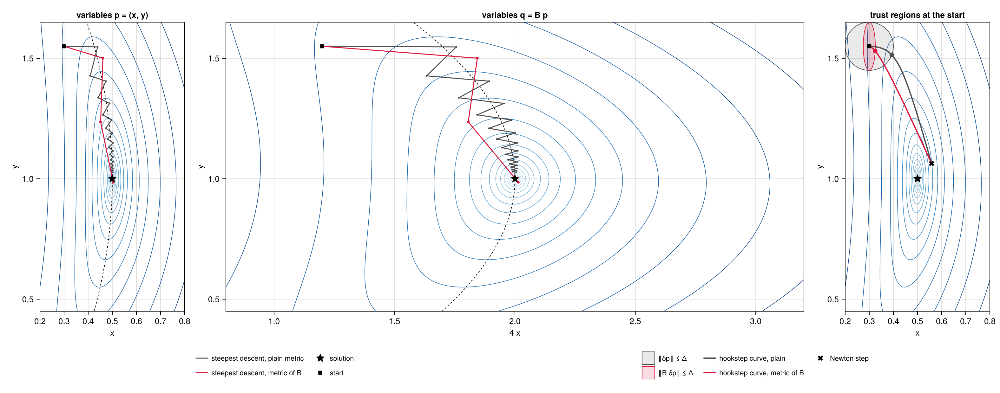

# Preconditioning

Both methods converge at a rate set by the spectrum of the linearised residual. For the PDEs in
which periodic orbits matter, that spectrum is spread over many decades, and without a
preconditioner neither L-BFGS nor the Krylov solver of the hookstep makes useful progress. This
page explains why, how a preconditioner enters the two methods, and what is known about choosing
it. The [Examples](../examples/lorenz.md) measure the effect of several choices. Equations of the
other theory pages are cited as (F*n*) for the [Space-time formulation](@ref), (O*n*) for
[Search by optimisation](@ref) and (R*n*) for [Search by root finding](@ref).

## Why the space-time problem is stiff

Write the Jacobian of the residual, the first block row of (R4), as

```math
\mathcal{J}_r\,\delta p = \mathcal{J}_u\,\delta u + \omega\,\partial_s u\;\delta\rho
                         - \sum_i \partial_i u\;\delta c_i ,
\qquad \mathcal{J}_u = \omega\,\partial_s - \sum_i c_i\,\partial_i - L . \tag{1}
```

$\mathcal{J}_u$ is the field block of the Jacobian, the derivative of the residual with respect to
the field. On a Fourier mode $e^{\mathrm{i}(k\cdot x + n s)}$, with spatial wavenumber $k$ and
temporal index $n$, the derivatives are multiplications, $\partial_s \to \mathrm{i}\,n$ and
$\partial_i \to \mathrm{i}\,k_i$. Consider a dissipative PDE whose linear part multiplies the mode
by $-d(k)$, with $d(k) > 0$ growing with $k$. Up to the coupling by the nonlinear terms,
$\mathcal{J}_u$ multiplies the mode by

```math
\lambda_{kn} \approx \mathrm{i}\,\big(\omega\, n - c\cdot k\big) + d(k) , \tag{2}
```

nearly an eigenvalue. Its size ranges from order one, for the largest scales, to $\omega n_{\max}$
along the rescaled time and $d(k_{\max})$ along space. The latter is $\nu k_{\max}^2$ for viscous
diffusion and $k_{\max}^4$ for the Kuramoto–Sivashinsky equation. An ODE is stiff in the same way.
For the Lorenz system the time derivative alone spans $\omega n$ from 0 to $\omega K$ with $K$
modes. The two methods see this spread in different ways.

- L-BFGS minimises $R$ (O1). Near a minimiser its Hessian is, in the Gauss–Newton approximation,
  $\mathcal{J}_r^+ \mathcal{J}_r$, with eigenvalues $|\lambda_{kn}|^2$. The condition number grows
  like $k_{\max}^8$ for Kuramoto–Sivashinsky. L-BFGS starts every recursion from $\theta I$ and
  corrects it with a handful of curvature pairs (O7). It cannot capture such a spectrum, and
  behaves like steepest descent.
- GMRES, the Krylov solver of the hookstep, minimises the residual of the linear model over
  polynomials in $\mathcal{J}$ of degree $n$. It converges fast when the eigenvalues of
  $\mathcal{J}$ are clustered away from the origin, and slowly when they spread over a wide region
  of the complex plane. Here they lie along lines parallel to the imaginary axis, at distance
  $d(k)$ from it and up to $\pm\,\omega n_{\max}$ along it. The Krylov space must grow to almost
  the dimension of the problem before the residual drops.

The parameters add scales of their own. The columns of $\mathcal{J}$ multiplying $\delta\rho$ and
$\delta c_i$ are $\omega\,\partial_s u$ and $-\partial_i u$, so $\rho$ and $c_i$ have curvatures
$\lVert \omega\,\partial_s u\rVert^2$ and $\lVert \partial_i u\rVert^2$, generally far from that of
a single field component.

Compare with the classical Newton–Krylov *shooting* methods for periodic orbits (Sánchez et al.
2004; Viswanath 2007), which solve $\Phi_T(u) - u = 0$ with $\Phi_T$ the flow over a period. There
the Jacobian is $M - I$, with $M$ the monodromy matrix. Dissipation makes almost all eigenvalues of
$M$ tiny, so those of $M - I$ cluster at $-1$, and GMRES needs only as many vectors as there are
weakly stable or unstable directions. Time integration acts as an implicit preconditioner. The
space-time formulation gives it up, in exchange for avoiding the exponential growth of errors along
long and unstable orbits, and must supply a preconditioner explicitly.

## A preconditioner as a change of metric

A preconditioner is an invertible operator $\mathcal{B}$ on orbits, cheap to invert, that captures
the stiff part of the problem. It defines the metric

```math
\langle p, q\rangle_{\mathcal{B}} = \langle \mathcal{B} p, \mathcal{B} q\rangle = \langle p, M q\rangle, \qquad M = \mathcal{B}^+ \mathcal{B} , \tag{3}
```

in which each direction is measured by its size under $\mathcal{B}$. The solutions $r = 0$ do not
depend on $\mathcal{B}$. Only the paths of the two methods do.

### L-BFGS in the metric of the preconditioner

By the Riesz representation theorem, as in (O2), the gradient in this metric is
$M^{-1}\nabla R$. Running L-BFGS in it changes the two-loop recursion in two places. The initial
inverse Hessian is

```math
H_0 = \theta\, M^{-1}, \qquad \theta = \frac{\langle y, s\rangle}{\langle y, M^{-1} y\rangle} ,
\tag{4}
```

instead of $\theta I$, and the first direction, with no curvature pairs, is $d = -M^{-1} g$. The
Armijo condition (O8) is unchanged, and the cautious test (O7) is kept in the plain norms as a
safeguard. If $\mathcal{B}$ captures the stiff part of $\mathcal{J}_r$, the preconditioned Hessian
$M^{-1}\mathcal{J}_r^+ \mathcal{J}_r$ has a narrow spectrum, and the curvature pairs only need to
learn the nonlinear corrections.

### Hookstep with right preconditioning

The step is written as $\delta p = \mathcal{B}^{-1} z$, and the Arnoldi iteration runs on
$\mathcal{J} \mathcal{B}^{-1}$,

```math
\mathcal{J} \mathcal{B}^{-1} Q_n = Q_{n+1} H, \qquad \delta p = \mathcal{B}^{-1} Q_n y . \tag{5}
```

The derivation (R7)–(R9) goes through with $z = Q_n y$ in place of $\delta p$,

```math
\lVert b - \mathcal{J}\,\delta p\rVert = \lVert g - H y\rVert , \qquad
\lVert y\rVert = \lVert \mathcal{B}\,\delta p\rVert = \lVert \delta p\rVert_{\mathcal{B}} . \tag{6}
```

The residual of the model, and so the predicted reduction of the trust-region update, is unchanged.
Right preconditioning does not alter the quantity being minimised, only the space in which the step
is sought. The trust region becomes the ellipsoid $\lVert \delta p\rVert_{\mathcal{B}} \le \Delta$,
and stiff directions, large under $\mathcal{B}$, are allowed only short steps. When $\mathcal{B}$
approximates $\mathcal{J}$, the spectrum of $\mathcal{J}\mathcal{B}^{-1}$ is clustered near one and
the Krylov spaces are small.

### Flexible GMRES

A preconditioner applied inexactly, for instance by a few steps of an inner iterative solver, is a
different operator $\mathcal{B}_j^{-1}$ at each Arnoldi step. Then $\mathcal{B}^{-1} Q_n y$ is no
longer the step that the model (6) describes. Keeping the vectors $z_j = \mathcal{B}_j^{-1} q_j$
restores it,

```math
\mathcal{J} Z_n = Q_{n+1} H, \qquad \delta p = Z_n y , \qquad
\lVert b - \mathcal{J}\,\delta p\rVert = \lVert g - H y\rVert , \tag{6a}
```

whatever the preconditioner did (Saad 1993). The trust region still bounds $\lVert y\rVert$, which
is now a length in the coordinates of the Krylov space rather than in a fixed metric. The option
`flexible=true` of [`NewtonHookstep`](@ref) does this, at the cost of storing $Z_n$, as many vectors
as $Q_n$. It also forms each trial step without applying $\mathcal{B}^{-1}$.

### One operator for both methods

The hookstep applies $\mathcal{B}^{-1}$, and L-BFGS applies
$M^{-1} = \mathcal{B}^{-1}\mathcal{B}^{-+}$. With the same $\mathcal{B}$ both methods work in the
same metric, and a search that runs L-BFGS and then the hookstep keeps a consistent notion of step
length. In the code, a preconditioner type extends two functions, `precondition!` and
`precondition_adjoint!`, which apply $\mathcal{B}^{-1}$ and $\mathcal{B}^{-+}$ (see [Usage](@ref)).

## A picture in two dimensions

The effect of the metric can be seen on a system of two quadratic equations in two unknowns,
$p = (x, y)$,

```math
r_1 = 4\,(x - \tfrac12) + (y - 1)^2 , \qquad r_2 = (x - \tfrac12)^2 + (y - 1) , \tag{7}
```

with the solution $p_\star = (\tfrac12, 1)$, where the Jacobian is $\mathrm{diag}(4, 1)$. The
problem is four times stiffer along $x$ than along $y$. The Gauss–Newton Hessian of
$R = \tfrac12\lVert r\rVert^2$ is $\mathcal{J}_r^\top \mathcal{J}_r = \mathrm{diag}(16, 1)$,
sixteen times stiffer, and the level sets of $R$ around the solution are ellipses four times longer
along $y$ than along $x$. The preconditioner is $\mathcal{B} = \mathrm{diag}(4, 1)$, the Jacobian
at the solution. The script is `examples/metric/metric.jl`.



*Left, level sets of $R$ (blue) in the variables $p = (x, y)$, the zero set of $r_1$ (dashed),
and steepest descent from the same start in the plain metric (grey) and in the metric of
$\mathcal{B}$ (red). Centre, the same in the variables $q = \mathcal{B}p = (4x, y)$. Right, at the
start, the trust regions $\lVert \delta p\rVert \le \Delta$ (grey) and
$\lVert \mathcal{B}\,\delta p\rVert \le \Delta$ (red), the hookstep curves of the two metrics from
the Newton step (cross) towards steepest descent, and the hooksteps on the two boundaries (dots).*

### Steepest descent in the two metrics

In the plain metric the steepest-descent direction $-\nabla R$ is normal to the level sets. In a
narrow valley it points across the valley, not along it. The path of steepest descent with a line
search zigzags from one side to the other (left, grey), and after 25 iterations $R$ is still
$3.6 \times 10^{-4}$. In the metric of $\mathcal{B}$ lengths are measured as
$\lVert \mathcal{B}\,\delta p\rVert$, and a step along $x$ counts four times more than the same
step along $y$. The steepest-descent direction becomes $-M^{-1}\nabla R$, with
$M = \mathcal{B}^\top \mathcal{B}$, the direction that reduces $R$ fastest per unit of *this*
length. Its first step, like the plain one, goes mostly along $x$ and reaches the floor of the
valley. The following ones run along the valley instead of across it, and the path reaches the
solution, to rounding, in 6 iterations (left, red).

### A change of variables

In the variables $q = \mathcal{B}p$ the metric of $\mathcal{B}$ is the plain one,
$\lVert \mathcal{B}\,\delta p\rVert = \lVert \delta q\rVert$. The level sets of
$\tilde R(q) = R(\mathcal{B}^{-1}q)$ are nearly circles around the solution (centre), since the
stretching of $x$ by a factor of four removes the stiffness. Near the solution, plain steepest
descent in $q$ points at the solution. Its path, mapped back with $p = \mathcal{B}^{-1}q$, is the
red path on the left. The two descriptions are the same algorithm. With
$\nabla_q \tilde R = \mathcal{B}^{-\top}\nabla R$, a plain step in $q$,
$\delta q = -\alpha\, \nabla_q \tilde R$, is the step
$\delta p = \mathcal{B}^{-1}\delta q = -\alpha\, \mathcal{B}^{-1}\mathcal{B}^{-\top}\nabla R = -\alpha\, M^{-1}\nabla R$
in $p$.

### L-BFGS in the new variables

Running L-BFGS in the metric of $\mathcal{B}$ is exactly running plain L-BFGS on $\tilde R(q)$,
and this is how the code implements it, without ever forming $q$. The curvature pairs in the
variables $q$ are $s_q = \mathcal{B} s$ and $y_q = \mathcal{B}^{-\top} y$, so that

```math
\langle y_q, s_q\rangle = \langle y, s\rangle , \qquad
\langle y_q, y_q\rangle = \langle y, M^{-1} y\rangle , \qquad
\langle s_q, s_q\rangle = \lVert s\rVert_{\mathcal{B}}^2 .
```

The scaling of the initial inverse Hessian of plain L-BFGS in $q$,
$\theta = \langle y_q, s_q\rangle / \langle y_q, y_q\rangle$, is the $\theta$ of (4), and its
initial inverse Hessian $\theta I$ in $q$ is $\theta M^{-1}$ in $p$. The two-loop recursion only
needs inner products of these vectors and the action of the initial inverse Hessian. In $p$ this
action is the application of $\mathcal{B}^{-1}\mathcal{B}^{-+}$, that is `precondition_adjoint!`
followed by `precondition!`. The convergence is governed by the Hessian of $\tilde R$, whose
Gauss–Newton approximation is $(\mathcal{J}_r \mathcal{B}^{-1})^\top (\mathcal{J}_r \mathcal{B}^{-1})$,
and so by the singular values of $\mathcal{J}_r \mathcal{B}^{-1}$.

### The hookstep in the new variables

The same change of variables applies to the Newton system. In $q$ the residual is
$r(\mathcal{B}^{-1}q)$, whose Jacobian is $\mathcal{J}\mathcal{B}^{-1}$. The Arnoldi iteration runs
on this operator, and its basis $Q_n$ spans a Krylov space *of the variables $q$*. The hookstep is
computed there, $z = Q_n y$ with $\lVert y\rVert = \lVert z\rVert \le \Delta$, a ball in $q$, and
mapped back to the orbit by $\mathcal{B}^{-1}$,

```math
\delta p = \mathcal{B}^{-1} z = \mathcal{B}^{-1} Q_n y , \qquad \lVert \mathcal{B}\,\delta p\rVert = \lVert y\rVert \le \Delta . \tag{8}
```

This is (5). The factor $\mathcal{B}^{-1}$ in front of $Q_n y$ maps the variables $q$, in which
GMRES and the trust region work, back to the orbit. In the variables $p$ the ball is the ellipsoid
$\lVert \mathcal{B}\,\delta p\rVert \le \Delta$ (right, red), short along the stiff direction $x$
and long along $y$. The hookstep curves start from the same Newton step, which does not depend on
the metric. As the trust region shrinks they turn towards the steepest-descent direction of their
own metric, $-\nabla R$ or $-M^{-1}\nabla R$. With $\Delta = 0.1$ the hookstep on the circle (grey
dot) is $\delta p = (0.093, -0.036)$, almost entirely along the stiff direction $x$ and at an
angle of $41^\circ$ to the Newton step. The hookstep on the ellipse (red dot) is
$\delta p = (0.025, -0.020)$, a quarter as long along $x$, at an angle of $23^\circ$ to the
Newton step. The trust region of $\mathcal{B}$ measures each direction against its own stiffness
and keeps the step closer to the Newton direction. A good preconditioner therefore helps the
hookstep in two ways. GMRES converges in fewer steps, because $\mathcal{J}\mathcal{B}^{-1}$ is
close to the identity, and the trust region has the shape of the problem.

## Choosing the preconditioner

The general principle of Newton–Krylov methods for PDEs is *physics-based* preconditioning (Knoll &
Keyes 2004). The preconditioner $\mathcal{B}$ is an approximation of the Jacobian built from the
part of the physics that makes the problem stiff, simple enough to invert cheaply. For the
space-time residual three diagonal ingredients are natural, and the examples compare them. Each is
built about an orbit $(u_0, \log\omega_0, c_0)$, with frequency $\omega_0$, drift speeds $c_0$ and
field $u_0$. Each is described by the number $b_{kn}$ by which $\mathcal{B}$ multiplies a Fourier
mode.

1. The time derivative, $b_{kn} = 1 + \omega_0 |n|$, captures the scale of $\omega\,\partial_s$.
   It maps the eigenvalues $\mathrm{i}\,\omega n$ of the time derivative to
   $\mathrm{i}\,\omega n / (1 + \omega_0 |n|) \to \pm\,\mathrm{i}$. These form two clusters on the
   imaginary axis, which make the cost independent of the resolution but are not the single
   cluster near one that GMRES prefers.
2. The dissipation, $b_{kn} = 1 + d(k)$, captures the spatial stiffness. It is $1 + k^4$ for
   Kuramoto–Sivashinsky. It is the space-time counterpart of the Laplacian or Stokes
   preconditioners of time-stepping and steady-state solvers (Tuckerman & Barkley 2000).
3. The linear space-time operator, $b_{kn} = \lambda_{kn}$ of (2), combines the two. Here $\omega$
   and $c$ are frozen at $\omega_0$ and $c_0$ and the linear operator is taken at a reference
   state. It maps the linear part of $\mathcal{J}$ to the identity. For Kuramoto–Sivashinsky,
   whose orbits have zero mean, the linearisation about the mean state $u = 0$ gives the diagonal
   multiplier $\mathrm{i}(\omega_0 n - c_0 k) + k^4 - k^2$. For the Lorenz system the
   linearisation about the mean state $\bar u$ of the orbit gives
   $\mathrm{i}\,\omega_0 n\, I - J(\bar u)$, one $3 \times 3$ block per mode. For a flow it is the
   linear operator about the mean flow, block diagonal over the wavenumbers.

The third choice is complex, and not self-adjoint. A real, positive variant keeps only its size,
$b_{kn} = 1 + |\lambda_{kn}|$. It rescales every mode as the operator does but leaves its phase in
place. The eigenvalues of the linear part of $\mathcal{J}\mathcal{B}^{-1}$ then lie near the arc
$\lambda_{kn} / |\lambda_{kn}|$ of the unit circle, from $-\mathrm{i}$ through $1$ to
$+\mathrm{i}$, rather than near $1$. The two variants have opposite merits for the two methods.
For the hookstep only $\mathcal{J}\mathcal{B}^{-1}$ matters, and the complex operator, which
clusters the spectrum at one, is the better choice. For L-BFGS the metric
$M = \mathcal{B}^+\mathcal{B}$ multiplies each mode by $|b_{kn}|^2 = |\lambda_{kn}|^2$. This is
close to zero on the slow, linearly unstable modes, where $\lambda_{kn}$ is small. The gradient
$M^{-1}\nabla R$ then amplifies these modes by large factors, and the positive variant, bounded
below by one, gives a better metric. Nothing requires the same $\mathcal{B}$ for both methods. A
[`System`](@ref) can be rebuilt with a different preconditioner between the L-BFGS and the
hookstep phases of a search.

On the parameters $\mathcal{B}$ acts as the scalars $\lVert \omega_0\,\partial_s u_0\rVert$ and
$\lVert \partial_i u_0\rVert$, the square roots of their Gauss–Newton curvatures, computed on the
orbit about which $\mathcal{B}$ is built. L-BFGS keeps $\mathcal{B}$ fixed for a whole run, since a
changing metric would make the curvature pairs inconsistent. The hookstep rebuilds it about the
current orbit at the start of every Newton iteration, through `relinearise!`, unless
`relinearise=false` (see [Usage](@ref)).

### Beyond diagonal preconditioners

A diagonal $\mathcal{B}$ captures the linear part of the problem only. When the nonlinear term
dominates the spatial operator at the energetic scales, as in Kolmogorov flow, no diagonal operator
can account for it. Split the field block as
$\mathcal{J}_u = \mathcal{J}_\mathrm{t} + \mathcal{J}_\mathrm{x}$, with the time derivative
$\mathcal{J}_\mathrm{t} = \omega\,\partial_s$ and the spatial operator
$\mathcal{J}_\mathrm{x} = -\sum_i c_i\,\partial_i - L$. The first is diagonal in the temporal
Fourier modes. The second acts on each instant separately, so that it is block diagonal at the
instants. Their product, shifted by $\sigma > 0$,

```math
\mathcal{B} = \frac{1}{\sigma}\,(\mathcal{J}_\mathrm{t} + \sigma)(\sigma + \mathcal{J}_\mathrm{x})
            = \mathcal{J}_u + \sigma + \frac{1}{\sigma}\,\mathcal{J}_\mathrm{t}\mathcal{J}_\mathrm{x} , \tag{9}
```

contains the field block and is inverted factor by factor, each in its own basis. This is the
approximate factorisation of alternating-direction implicit methods, between time and space. The
blocks $\sigma + \mathcal{J}_\mathrm{x}(s_l)$ of a large system are solved by a few inner Krylov
iterations. This makes $\mathcal{B}^{-1}$ change from one Arnoldi step to the next, and calls for
flexible GMRES. The [Kolmogorov flow](../examples/kolmogorov_flow.md) page describes this
preconditioner, its parameters and its cost.

Two cautions from the theory of Krylov methods apply. The convergence of GMRES for a non-normal
operator is not determined by its eigenvalues alone (Greenbaum, Pták & Strakoš 1996), and the
condition number is a poor guide. What matters is that the spectrum of $\mathcal{J}\mathcal{B}^{-1}$
is clustered and that the operator is not too far from normal (Wathen 2015). The examples show both
effects. Preconditioners with similar condition numbers give very different costs, and the
clustering of the eigenvalues explains the difference.

## Related work

Variational methods that minimise the space-time residual go back to Lan & Cvitanović (2004), who
evolve a loop in state space towards a periodic orbit with a Newton descent. They have been
developed with adjoint-based gradients for the Navier–Stokes equations by Farazmand (2016), Azimi,
Ashtari & Schneider (2022) and Parker & Schneider (2022). Newton–Krylov methods with hookstep trust
regions were introduced for relative periodic orbits of plane Couette flow by Viswanath (2007), on
the shooting formulation. Their theory, inexact Newton steps and the choice of the forcing terms are
in Dembo, Eisenstat & Steihaug (1982), Eisenstat & Walker (1996) and Knoll & Keyes (2004). GMRES is
due to Saad & Schultz (1986), and its flexible variant to Saad (1993). A general review of
preconditioning, with the role of spectral clustering and its limits, is Wathen (2015).

## References

- G. Azimi, O. Ashtari and T. M. Schneider, *Constructing periodic orbits of high-dimensional
  chaotic systems by an adjoint-based variational method*, Phys. Rev. E 105, 014217 (2022).
- R. S. Dembo, S. C. Eisenstat and T. Steihaug, *Inexact Newton methods*, SIAM J. Numer. Anal. 19,
  400–408 (1982).
- S. C. Eisenstat and H. F. Walker, *Choosing the forcing terms in an inexact Newton method*, SIAM
  J. Sci. Comput. 17, 16–32 (1996).
- M. Farazmand, *An adjoint-based approach for finding invariant solutions of Navier–Stokes
  equations*, J. Fluid Mech. 795, 278–312 (2016).
- L. Giraud, J. Langou and M. Rozložník, *The loss of orthogonality in the Gram–Schmidt
  orthogonalization process*, Comput. Math. Appl. 50, 1069–1075 (2005).
- A. Greenbaum, V. Pták and Z. Strakoš, *Any nonincreasing convergence curve is possible for
  GMRES*, SIAM J. Matrix Anal. Appl. 17, 465–469 (1996).
- D. A. Knoll and D. E. Keyes, *Jacobian-free Newton–Krylov methods: a survey of approaches and
  applications*, J. Comput. Phys. 193, 357–397 (2004).
- Y. Lan and P. Cvitanović, *Variational method for finding periodic orbits in a general flow*,
  Phys. Rev. E 69, 016217 (2004).
- J. P. Parker and T. M. Schneider, *Variational methods for finding periodic orbits in the
  incompressible Navier–Stokes equations*, J. Fluid Mech. 941, A17 (2022).
- Y. Saad, *A flexible inner-outer preconditioned GMRES algorithm*, SIAM J. Sci. Comput. 14,
  461–469 (1993).
- Y. Saad and M. H. Schultz, *GMRES: a generalized minimal residual algorithm for solving
  nonsymmetric linear systems*, SIAM J. Sci. Stat. Comput. 7, 856–869 (1986).
- J. Sánchez, M. Net, B. García-Archilla and C. Simó, *Newton–Krylov continuation of periodic
  orbits for Navier–Stokes flows*, J. Comput. Phys. 201, 13–33 (2004).
- L. S. Tuckerman and D. Barkley, *Bifurcation analysis for timesteppers*, in *Numerical Methods for
  Bifurcation Problems and Large-Scale Dynamical Systems*, IMA Vol. Math. Appl. 119, 453–466,
  Springer (2000).
- D. Viswanath, *Recurrent motions within plane Couette turbulence*, J. Fluid Mech. 580, 339–358
  (2007).
- A. J. Wathen, *Preconditioning*, Acta Numerica 24, 329–376 (2015).
