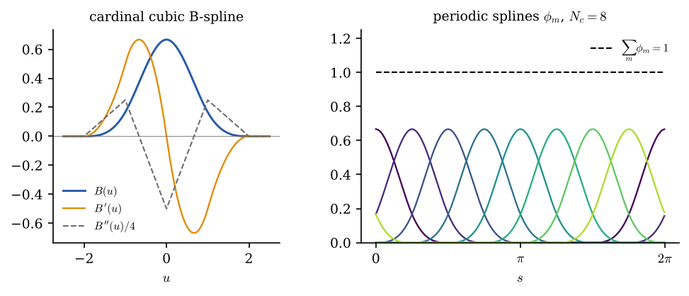
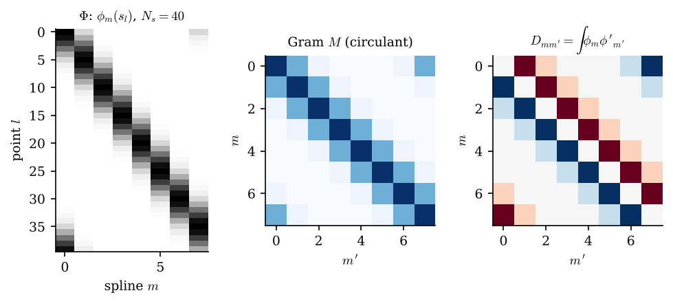
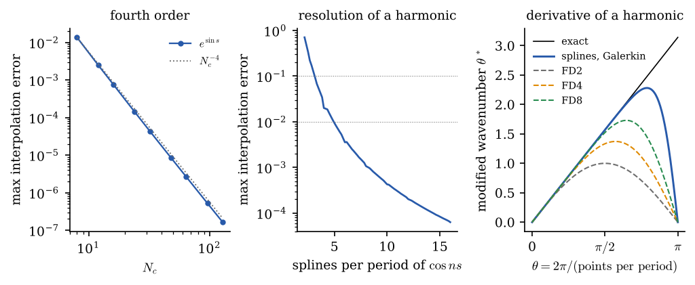

# PeriodicBSplines.jl

Periodic cubic B-splines on a uniform grid of the circle [0, 2π): values and derivatives on a finer
uniform grid (sparse collocation matrices), exact Gram matrices, interpolation, and the Fourier
symbols that measure how well the splines resolve and differentiate a harmonic.

It provides the coarse time grid of the two-grid preconditioner `TwoGrid` of
[ReSolver](https://github.com/Davide-Lasagna-s-Lab/ReSolver.jl), where it lives as a sub-package
(`lib/PeriodicBSplines.jl`). Everything it computes is derived in the documentation
(`docs/src/theory.md`), with the figures below.



```julia
using PeriodicBSplines
Φ, Φ′ = collocation(48, 16)          # values and derivatives of 16 splines at 48 points
M, D  = gram(16), derivative_gram(16) # exact ∫ φ_m φ_m′ and ∫ φ_m φ_m′′
c = interpolate(sin.(2π .* (0:15) ./ 16))
evaluate(c, 0.3)                      # ≈ sin(0.3)
```



How coarse can the grid be? About 5 splines per period interpolate a harmonic to 1%, and the
Galerkin derivative `M⁻¹D` differentiates it to 0.01%, far better than centred differences of
order 8 with the same number of points:



| | |
|---|---|
| tests | `julia --project=. -e 'using Pkg; Pkg.test()'` |
| documentation | `julia --project=docs docs/make.jl` (HTML in `docs/build`) |
| figures | `julia --project=docs docs/figures.jl && python3 docs/figures.py` |
